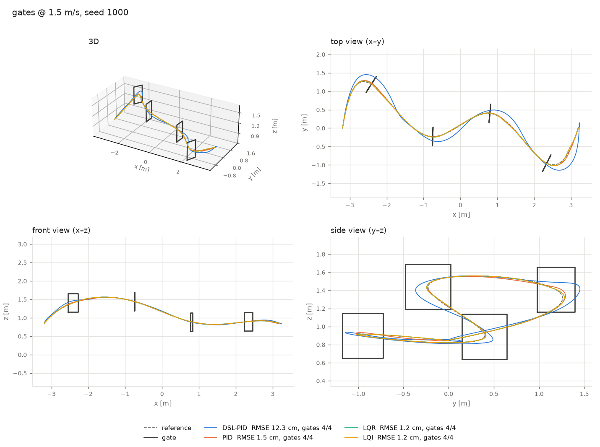
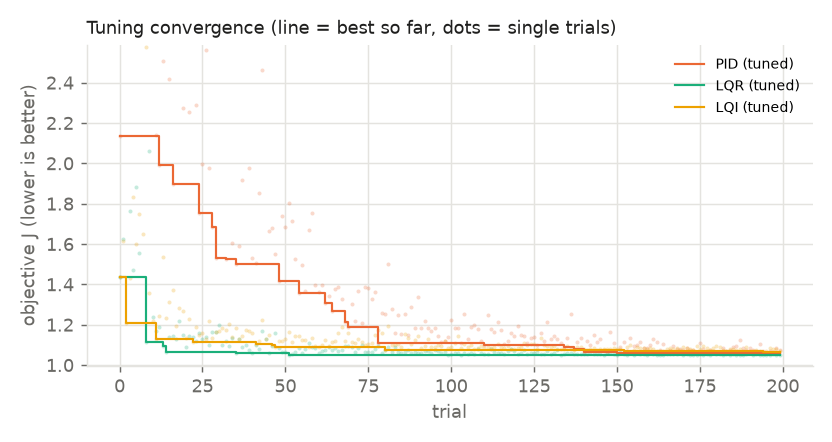
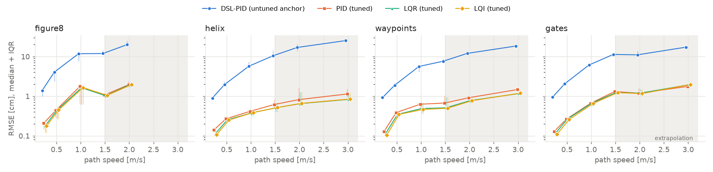
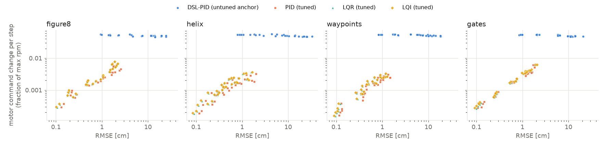
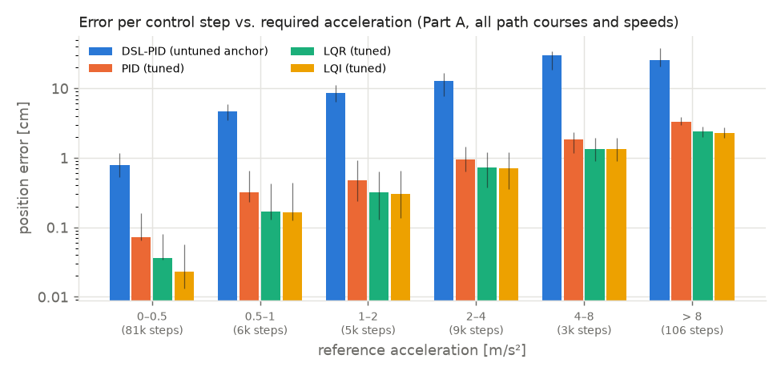
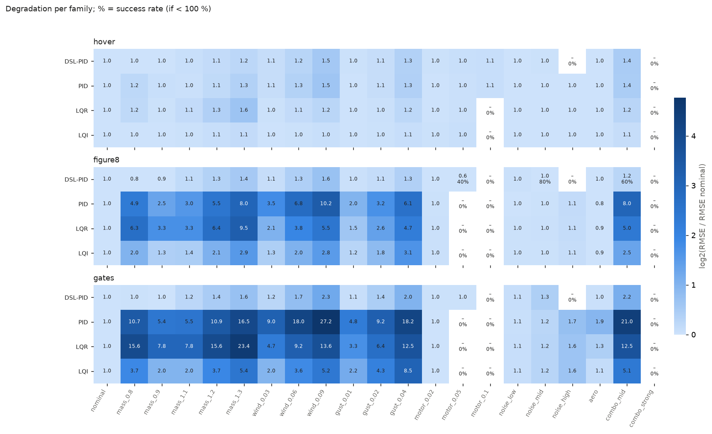
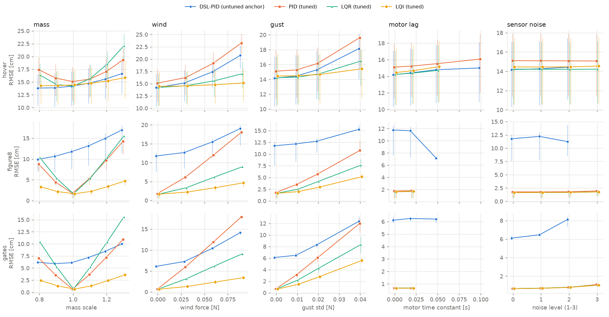
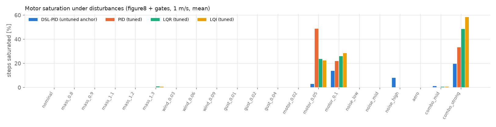

# drone-control-benchmark

**How do classical, learned and physics-informed controllers cope when the world doesn't match the model?**

This project compares quadrotor controllers on the same flight courses and under the same disturbances:

| Family | Methods |
|---|---|
| Classical | cascaded PID (reference: gym-pybullet-drones `DSLPIDControl` [1]), own PID, LQR, LQI |
| Learned | PPO / SAC (stable-baselines3) |
| Physics-informed | learned dynamics model (black-box vs. physics-informed NN) + sampling MPC |
| Hybrid | residual RL on top of PID |

Disturbances: aerodynamic drag, ground effect, constant wind + gusts, mass change (payload), motor lag, sensor noise, harder courses.

Everything runs on a **CPU only** (developed on a 2-core laptop).

> Status: **Stage 1 – classical controllers** (randomised courses, own PID / LQR / LQI, fair tuning, first benchmark).

## Architecture

```
controllers (PID / RL / MPC) ──act(state, ref)──►  Backend interface  ◄── PyBullet (gym-pybullet-drones)
        ▲                                               │                 (NumPy sim possible later)
        └──────── courses: reference(t) ◄── runner ─────┴──► metrics / plots / benchmark
```

All controllers talk to a simulator-agnostic `Backend` (`reset`, `step(rpm)`, `observe`), so a second simulator can be plugged in without touching any controller.

## Quickstart

Requires Python ≥ 3.12. On Windows, PyBullet has no pip wheel – use conda-forge:

```bash
conda create -n dronebench -c conda-forge python=3.12 pybullet   # Linux/macOS: a venv + pip works too
conda activate dronebench
pip install torch --index-url https://download.pytorch.org/whl/cpu
pip install git+https://github.com/utiasDSL/gym-pybullet-drones.git
pip install -e ".[dev]"

pytest                                                   # unit + physics sanity tests
python scripts/run_course.py --config configs/hover_pid.yaml
python scripts/run_course.py --config configs/hover_pid.yaml --course figure8
python scripts/run_course.py --course gates --speed 1.5 --controller lqi --seed 1000
python scripts/speed_test.py                             # simulator throughput on your machine

python scripts/tune.py --controller pid lqr lqi --trials 200          # fixed tuning protocol
python scripts/benchmark.py --config configs/benchmark/stage1.yaml    # resumable, 2 processes
python scripts/analyze.py --csv results/benchmark/stage1.csv          # tables, plots, this README
python scripts/plot_course.py --course gates --speed 1.5 --seed 1000   # 3D + side views
```

## Courses

Every course is generated deterministically from `(family, speed, seed)`:

| Family | Random parameters | Use |
|---|---|---|
| `hover` | target altitude 0.5–1.5 m (take-off from 0.1 m) | tuning + test |
| `figure8` | width, aspect ratio, rotation, altitude | tuning + test |
| `helix` | radius 0.5–2 m, 1–2 turns, climb | tuning + test |
| `waypoints` | 4–6 random points, ≥ 1 m apart | tuning + test |
| `gates` | 4–5 gates (0.5 × 0.5 m) as objects: spacing 1.2–1.8 m, lateral offset 0.2–1.2 m (usually alternating sides), height 0.7–1.6 m | **test only** (unseen family) |

The path is a cubic spline re-parametrised by arc length and flown at constant speed with a 2 m/s² ramp at start and end; the reference provides position, velocity and acceleration. A course is accepted only if it needs ≤ 80 % of the maximum thrust and ≤ 45° tilt (otherwise re-drawn, at most 50 times, else marked *infeasible* and not flown). A gate counts as passed only if the drone crosses the gate plane inside the opening in the flight direction. Path courses start exactly on the reference at rest, so the RMSE measures tracking, not the recovery from a random start offset.

## Metrics

Success rate (no crash, inside the arena, tilt < 80°) and – over successful flights – position RMSE, max error, steady-state error, settling time, IAE / ISE / ITAE, control effort, command smoothness, gates passed and controller compute time per step.

## Tuning and evaluation protocol

Published comparisons often pit a carefully designed method against a PID baseline whose tuning is not reported. Here every tunable controller gets **the same, fixed budget and objective**:

* **Objective** `J = mean_f(RMSE_f / RMSE_ref,f) + 0.3 · mean_f(smooth_f / smooth_ref,f) + 1.0 · crash rate`, nominal conditions only. Each course family f is normalised by fixed reference scales (default LQR), so hover take-off and path tracking count equally; *smooth* is the mean motor-command change per step, so overly aggressive gains are penalised (10 % smoother ≙ 3 % more error).
* **Optuna TPE**, 200 trials × 8 episodes (2 per family hover / figure8 / helix / waypoints, speed U(0.25, 1.5) m/s, tuning seeds 0–99). Each parameter is searched log-uniformly within ×/÷ 5 of its hand-set default (×/÷ 10 for integral gains); trial 0 is the default.
* **Selection**: the best 5 trials are re-flown on 40 validation episodes (seeds 100–199); the best on validation wins – this guards against lucky trials.
* **Anchor**: the original `DSLPIDControl` of gym-pybullet-drones [1] is *not* tuned. If the tuned own PID were worse than this anchor, the tuning would be broken.
* **Test**: frozen controllers on seeds 1000+ that were never used before. All controllers fly exactly the same courses, start states, wind directions and noise realisations, so results are compared pairwise (Wilcoxon signed-rank).
* For comparison: Madebo et al. [2] tune their controller with PSO, 20 particles × 30 iterations = 600 evaluations.

Stage 1 benchmark (5 test seeds): **Part A** – speed sweep 0.25 / 0.5 / 1 / 1.5 m/s and *extrapolation* to 2 / 3 m/s on figure8, helix, waypoints, gates (+ hover); **Part B** – 21 disturbance scenarios (mass 0.8–1.3×, constant wind 0.03–0.09 N, gusts, motor lag 20–100 ms, sensor noise, drag + ground effect + downwash, two combinations) on hover, figure8 and gates at 1 m/s.

## Results (Stage 1)



<!-- STAGE1-RESULTS:START -->
### Tuning (validation set, 40 episodes, seeds 100–139)

| Controller | Trials | J default | J tuned | mean RMSE [cm] | CPU-h |
|---|---|---|---|---|---|
| PID | 200 | 2.0377 | 0.9444 | 7.4 → 5.1 | 0.77 |
| LQR | 200 | 1.2725 | 0.9449 | 5.3 → 4.8 | 0.80 |
| LQI | 200 | 1.2749 | 0.9607 | 5.4 → 4.9 | 0.66 |

Tuning convergence – PID: best J 1.058, 4.7 % gained in the second half; LQR: best J 1.048, 0.3 % gained in the second half; LQI: best J 1.066, 0.7 % gained in the second half.



### Part A – speed sweep (nominal)

Median position RMSE [cm] of successful flights / success rate, over 4 families × 5 seeds. Speeds above 1.5 m/s are outside the tuning range.

| Controller | 0.25 m/s | 0.5 m/s | 1 m/s | 1.5 m/s | 2 m/s | 3 m/s |
|---|---|---|---|---|---|---|
| DSL-PID (untuned anchor) | 0.9 / 100 % | 2.1 / 100 % | 6.2 / 100 % | 11.0 / 100 % | 14.1 / 100 % | 21.3 / 100 % |
| PID (tuned) | 0.1 / 100 % | 0.3 / 100 % | 0.6 / 100 % | 1.0 / 100 % | 1.2 / 100 % | 1.5 / 100 % |
| LQR (tuned) | 0.1 / 100 % | 0.3 / 100 % | 0.6 / 100 % | 1.0 / 100 % | 1.1 / 100 % | 1.2 / 100 % |
| LQI (tuned) | 0.1 / 100 % | 0.3 / 100 % | 0.6 / 100 % | 1.0 / 100 % | 1.1 / 100 % | 1.2 / 100 % |

Infeasible courses (rejected by the thrust/tilt check, not flown): 3 m/s: 10.

Gate course – all gates passed (successful flights): DSL-PID 96 %; PID 100 %; LQR 100 %; LQI 100 %.



### Accuracy vs. smoothness (Part A, one dot per flight)

Lower left is better. A controller can buy accuracy with more aggressive motor commands; the tuning objective weighs this trade-off (w_s = 0.3).



### Error vs. required acceleration (per control step)

Every control step of the nominal speed sweep is sorted by the reference acceleration at that moment (straights ≈ 0, tight turns and braking > 4 m/s²). Bars: median error, whiskers: interquartile range.



### Part B – disturbances (1 m/s), per course family

Success rate and median RMSE [cm] of successful flights; in brackets the RMSE relative to the nominal scenario of the same family (1.0 = no degradation). Hover includes the take-off from 0.1 m, so its RMSE is an order of magnitude larger.

<details><summary><b>hover</b></summary>

| Scenario | DSL-PID | PID | LQR | LQI |
|---|---|---|---|---|
| nominal | 100 %, 14.2 (1.00) | 100 %, 15.1 (1.00) | 100 %, 14.2 (1.00) | 100 %, 14.5 (1.00) |
| mass_0.8 | 100 %, 13.8 (0.98) | 100 %, 17.4 (1.15) | 100 %, 16.4 (1.15) | 100 %, 14.3 (0.99) |
| mass_0.9 | 100 %, 13.9 (0.98) | 100 %, 15.8 (1.04) | 100 %, 14.5 (1.02) | 100 %, 14.3 (0.99) |
| mass_1.1 | 100 %, 14.7 (1.04) | 100 %, 15.5 (1.03) | 100 %, 15.7 (1.10) | 100 %, 14.8 (1.02) |
| mass_1.2 | 100 %, 15.6 (1.10) | 100 %, 17.0 (1.13) | 100 %, 18.5 (1.30) | 100 %, 15.2 (1.05) |
| mass_1.3 | 100 %, 16.6 (1.17) | 100 %, 19.3 (1.28) | 100 %, 22.1 (1.55) | 100 %, 15.9 (1.10) |
| wind_0.03 | 100 %, 15.1 (1.07) | 100 %, 16.2 (1.07) | 100 %, 14.6 (1.03) | 100 %, 14.5 (1.01) |
| wind_0.06 | 100 %, 17.4 (1.23) | 100 %, 19.2 (1.27) | 100 %, 15.6 (1.10) | 100 %, 14.8 (1.02) |
| wind_0.09 | 100 %, 20.7 (1.46) | 100 %, 23.3 (1.54) | 100 %, 17.0 (1.20) | 100 %, 15.1 (1.05) |
| gust_0.01 | 100 %, 14.4 (1.02) | 100 %, 15.3 (1.01) | 100 %, 14.3 (1.01) | 100 %, 14.5 (1.00) |
| gust_0.02 | 100 %, 15.3 (1.08) | 100 %, 16.2 (1.07) | 100 %, 14.7 (1.04) | 100 %, 14.7 (1.01) |
| gust_0.04 | 100 %, 18.1 (1.28) | 100 %, 19.6 (1.30) | 100 %, 16.5 (1.16) | 100 %, 15.4 (1.07) |
| motor_0.02 | 100 %, 14.4 (1.02) | 100 %, 15.2 (1.01) | 100 %, 14.4 (1.01) | 100 %, 14.7 (1.02) |
| motor_0.05 | 100 %, 14.8 (1.04) | 100 %, 15.5 (1.03) | 100 %, 14.7 (1.03) | 100 %, 15.2 (1.05) |
| motor_0.1 | 100 %, 15.0 (1.06) | 100 %, 16.1 (1.06) | 0 %, – | 0 %, – |
| noise_low | 100 %, 14.3 (1.01) | 100 %, 15.1 (1.00) | 100 %, 14.2 (1.00) | 100 %, 14.5 (1.00) |
| noise_mid | 100 %, 14.4 (1.02) | 100 %, 15.1 (1.00) | 100 %, 14.2 (1.00) | 100 %, 14.5 (1.00) |
| noise_high | 0 %, – | 100 %, 15.1 (1.00) | 100 %, 14.2 (1.00) | 100 %, 14.5 (1.01) |
| aero | 100 %, 14.2 (1.00) | 100 %, 15.1 (1.00) | 100 %, 14.2 (1.00) | 100 %, 14.4 (1.00) |
| combo_mid | 100 %, 19.6 (1.38) | 100 %, 20.8 (1.38) | 100 %, 17.2 (1.21) | 100 %, 15.5 (1.07) |
| combo_strong | 0 %, – | 0 %, – | 0 %, – | 0 %, – |

</details>

<details><summary><b>figure8</b></summary>

| Scenario | DSL-PID | PID | LQR | LQI |
|---|---|---|---|---|
| nominal | 100 %, 11.8 (1.00) | 100 %, 1.8 (1.00) | 100 %, 1.6 (1.00) | 100 %, 1.6 (1.00) |
| mass_0.8 | 100 %, 9.9 (0.84) | 100 %, 8.8 (4.94) | 100 %, 10.3 (6.34) | 100 %, 3.3 (2.01) |
| mass_0.9 | 100 %, 10.6 (0.90) | 100 %, 4.4 (2.50) | 100 %, 5.3 (3.28) | 100 %, 2.2 (1.32) |
| mass_1.1 | 100 %, 13.1 (1.12) | 100 %, 5.3 (2.98) | 100 %, 5.4 (3.30) | 100 %, 2.2 (1.36) |
| mass_1.2 | 100 %, 15.0 (1.27) | 100 %, 9.7 (5.47) | 100 %, 10.4 (6.36) | 100 %, 3.4 (2.07) |
| mass_1.3 | 100 %, 17.0 (1.44) | 100 %, 14.2 (8.02) | 100 %, 15.6 (9.54) | 100 %, 4.7 (2.89) |
| wind_0.03 | 100 %, 12.7 (1.08) | 100 %, 6.1 (3.46) | 100 %, 3.3 (2.05) | 100 %, 2.2 (1.35) |
| wind_0.06 | 100 %, 15.5 (1.32) | 100 %, 12.0 (6.76) | 100 %, 6.2 (3.78) | 100 %, 3.4 (2.05) |
| wind_0.09 | 100 %, 19.0 (1.62) | 100 %, 18.0 (10.18) | 100 %, 8.9 (5.46) | 100 %, 4.6 (2.82) |
| gust_0.01 | 100 %, 12.2 (1.03) | 100 %, 3.5 (1.99) | 100 %, 2.5 (1.52) | 100 %, 2.0 (1.22) |
| gust_0.02 | 100 %, 12.7 (1.08) | 100 %, 5.7 (3.24) | 100 %, 4.2 (2.57) | 100 %, 3.0 (1.80) |
| gust_0.04 | 100 %, 15.3 (1.30) | 100 %, 10.8 (6.07) | 100 %, 7.6 (4.67) | 100 %, 5.2 (3.14) |
| motor_0.02 | 100 %, 11.7 (0.99) | 100 %, 1.8 (1.02) | 100 %, 1.7 (1.04) | 100 %, 1.7 (1.03) |
| motor_0.05 | 40 %, 7.2 (0.61) | 0 %, – | 0 %, – | 0 %, – |
| motor_0.1 | 0 %, – | 0 %, – | 0 %, – | 0 %, – |
| noise_low | 100 %, 12.2 (1.04) | 100 %, 1.8 (1.00) | 100 %, 1.7 (1.02) | 100 %, 1.7 (1.01) |
| noise_mid | 80 %, 11.2 (0.95) | 100 %, 1.8 (1.02) | 100 %, 1.7 (1.03) | 100 %, 1.7 (1.02) |
| noise_high | 0 %, – | 100 %, 1.9 (1.10) | 100 %, 1.8 (1.09) | 100 %, 1.8 (1.08) |
| aero | 100 %, 11.5 (0.98) | 100 %, 1.4 (0.82) | 100 %, 1.5 (0.90) | 100 %, 1.5 (0.89) |
| combo_mid | 60 %, 14.1 (1.20) | 100 %, 14.2 (8.02) | 100 %, 8.2 (5.04) | 100 %, 4.1 (2.49) |
| combo_strong | 0 %, – | 0 %, – | 0 %, – | 0 %, – |

</details>

<details><summary><b>gates</b></summary>

| Scenario | DSL-PID | PID | LQR | LQI |
|---|---|---|---|---|
| nominal | 100 %, 6.1 (1.00) | 100 %, 0.7 (1.00) | 100 %, 0.7 (1.00) | 100 %, 0.7 (1.00) |
| mass_0.8 | 100 %, 6.2 (1.01) | 100 %, 7.0 (10.69) | 100 %, 10.4 (15.58) | 100 %, 2.4 (3.67) |
| mass_0.9 | 100 %, 5.9 (0.97) | 100 %, 3.5 (5.37) | 100 %, 5.2 (7.83) | 100 %, 1.3 (1.99) |
| mass_1.1 | 100 %, 7.2 (1.17) | 100 %, 3.6 (5.53) | 100 %, 5.2 (7.84) | 100 %, 1.3 (2.01) |
| mass_1.2 | 100 %, 8.4 (1.38) | 100 %, 7.2 (10.91) | 100 %, 10.4 (15.59) | 100 %, 2.4 (3.68) |
| mass_1.3 | 100 %, 10.0 (1.64) | 100 %, 10.9 (16.54) | 100 %, 15.6 (23.37) | 100 %, 3.6 (5.45) |
| wind_0.03 | 100 %, 7.3 (1.19) | 100 %, 5.9 (8.98) | 100 %, 3.1 (4.71) | 100 %, 1.3 (1.96) |
| wind_0.06 | 100 %, 10.4 (1.70) | 100 %, 11.9 (18.04) | 100 %, 6.2 (9.24) | 100 %, 2.4 (3.58) |
| wind_0.09 | 100 %, 14.2 (2.32) | 100 %, 17.9 (27.19) | 100 %, 9.1 (13.64) | 100 %, 3.4 (5.16) |
| gust_0.01 | 100 %, 6.5 (1.06) | 100 %, 3.1 (4.75) | 100 %, 2.2 (3.30) | 100 %, 1.5 (2.25) |
| gust_0.02 | 100 %, 8.3 (1.36) | 100 %, 6.1 (9.22) | 100 %, 4.3 (6.38) | 100 %, 2.8 (4.26) |
| gust_0.04 | 100 %, 12.3 (2.02) | 100 %, 12.0 (18.22) | 100 %, 8.3 (12.50) | 100 %, 5.6 (8.47) |
| motor_0.02 | 100 %, 6.3 (1.02) | 100 %, 0.7 (1.00) | 100 %, 0.7 (1.00) | 100 %, 0.7 (0.99) |
| motor_0.05 | 100 %, 6.2 (1.02) | 0 %, – | 0 %, – | 0 %, – |
| motor_0.1 | 0 %, – | 0 %, – | 0 %, – | 0 %, – |
| noise_low | 100 %, 6.5 (1.06) | 100 %, 0.7 (1.05) | 100 %, 0.7 (1.06) | 100 %, 0.7 (1.06) |
| noise_mid | 100 %, 8.1 (1.33) | 100 %, 0.8 (1.20) | 100 %, 0.8 (1.22) | 100 %, 0.8 (1.21) |
| noise_high | 0 %, – | 100 %, 1.1 (1.66) | 100 %, 1.0 (1.56) | 100 %, 1.0 (1.57) |
| aero | 100 %, 6.3 (1.03) | 100 %, 1.3 (1.93) | 100 %, 0.9 (1.34) | 100 %, 0.7 (1.08) |
| combo_mid | 100 %, 13.2 (2.16) | 100 %, 13.9 (21.04) | 100 %, 8.3 (12.48) | 100 %, 3.4 (5.08) |
| combo_strong | 0 %, – | 0 %, – | 0 %, – | 0 %, – |

</details>



Degradation curves (median, bars = interquartile range of the 5 seeds; missing points = no successful flight):



### Motor saturation

Share of control steps in which at least one motor command sits at its limit (max rpm, or the minimum: 0 rpm for own controllers, PWM floor ≈ 9 440 rpm for DSL-PID). Mean over flights; crashed flights included.

| Controller | 0.25 m/s | 0.5 m/s | 1 m/s | 1.5 m/s | 2 m/s | 3 m/s |
|---|---|---|---|---|---|---|
| DSL-PID | 0 % | 0 % | 0 % | 0 % | 0 % | 0 % |
| PID | 0 % | 0 % | 0 % | 0 % | 0 % | 0 % |
| LQR | 0 % | 0 % | 0 % | 0 % | 0 % | 0 % |
| LQI | 0 % | 0 % | 0 % | 0 % | 0 % | 0 % |

Nominal flights stay below the limits at every speed – the feasibility check admits only courses that need ≤ 80 % of the maximum thrust. Saturation appears under disturbances, above all with motor lag:



### Paired comparison (same course, seed and disturbance; both controllers finished)

Hover and path courses are tested separately because their RMSE scales differ.

| Courses | A vs B | n | median(RMSE_A − RMSE_B) [cm] | A better in | Wilcoxon p |
|---|---|---|---|---|---|
| hover | dsl_pid vs pid | 100 | -1.01 | 99 % | 4.4e-18 |
| hover | dsl_pid vs lqr | 95 | +0.02 | 47 % | 7.9e-01 |
| hover | dsl_pid vs lqi | 95 | +0.00 | 49 % | 9.7e-03 |
| hover | pid vs lqr | 100 | +0.84 | 16 % | 2.1e-09 |
| hover | pid vs lqi | 100 | +1.05 | 0 % | 3.9e-18 |
| hover | lqr vs lqi | 100 | +0.22 | 36 % | 3.5e-05 |
| path courses | dsl_pid vs pid | 277 | +4.77 | 12 % | 3.0e-39 |
| path courses | dsl_pid vs lqr | 277 | +5.49 | 8 % | 4.0e-39 |
| path courses | dsl_pid vs lqi | 277 | +7.05 | 0 % | 3.5e-47 |
| path courses | pid vs lqr | 290 | +0.07 | 26 % | 1.2e-11 |
| path courses | pid vs lqi | 290 | +0.21 | 9 % | 4.1e-45 |
| path courses | lqr vs lqi | 290 | +0.01 | 26 % | 1.1e-21 |

Controller compute time per step (median): dsl_pid 0.902 ms, pid 0.507 ms, lqr 0.206 ms, lqi 0.223 ms.

_1760 episodes, git f70b31c-dirty, config f303f9309b_
<!-- STAGE1-RESULTS:END -->

## Roadmap

- [x] 0 – Foundation: backend interface, PyBullet backend with disturbances, courses, metrics, speed test, CI
- [x] 1 – Classical: randomised courses, own PID cascade, LQR / LQI, fair tuning, first benchmark + 3D course plots
- [ ] 2 – RL: Gymnasium env, PPO/SAC, curriculum hover → waypoints
- [ ] 3 – PINN + MPC: black-box vs. physics-informed dynamics, MPPI
- [ ] 4 – Hybrid: residual RL
- [ ] 5 – Disturbance benchmark (method × disturbance)
- [ ] 6 – Results write-up
- [ ] (optional) vectorised NumPy simulator + parity check against PyBullet

## License

MIT

## References

1. J. Panerati, H. Zheng, S. Zhou, J. Xu, A. Prorok, A. P. Schoellig, "Learning to Fly—a Gym Environment with PyBullet Physics for Reinforcement Learning of Multi-agent Quadcopter Control," *IEEE/RSJ International Conference on Intelligent Robots and Systems (IROS)*, 2021. [arXiv:2103.02142](https://arxiv.org/abs/2103.02142) · Code: [utiasDSL/gym-pybullet-drones](https://github.com/utiasDSL/gym-pybullet-drones)
2. M. M. Madebo, M. Y. Erten, H. Aydilek, "PSO-optimized physics-informed neural network-based fuzzy-sliding mode controller design for quadrotor altitude stabilization and trajectory tracking," *Ain Shams Engineering Journal*, vol. 17, art. 104312, 2026. [doi:10.1016/j.asej.2026.104312](https://doi.org/10.1016/j.asej.2026.104312)
