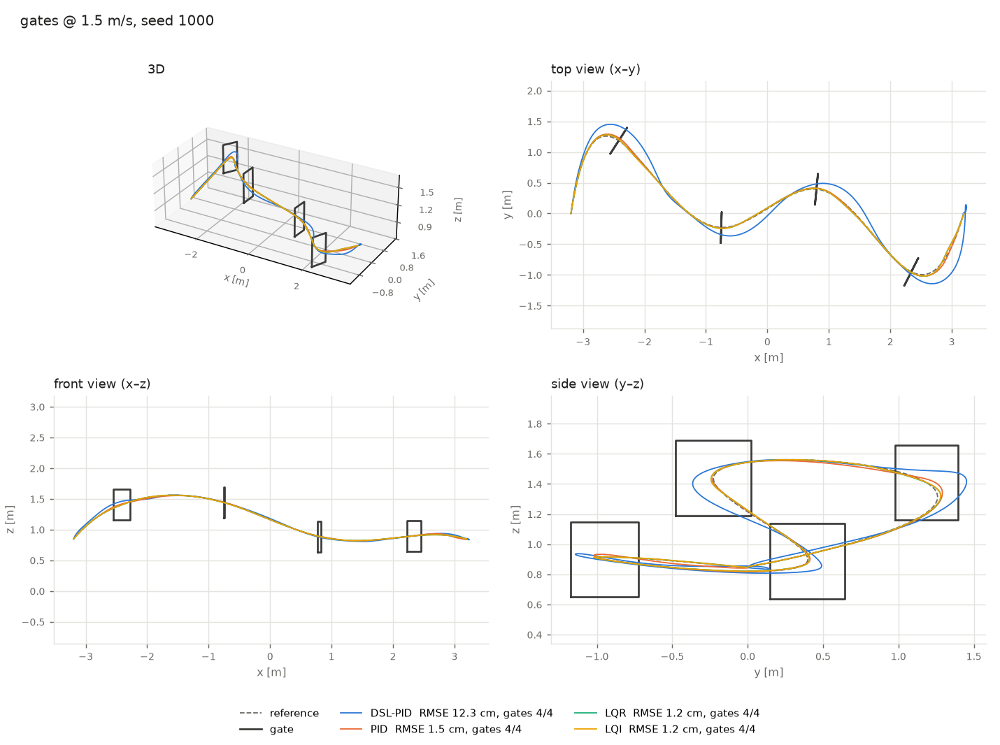
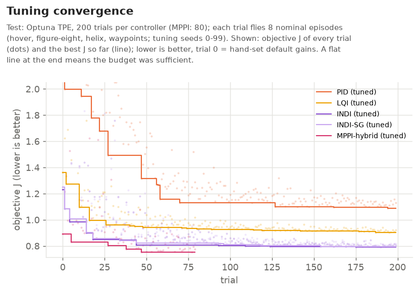
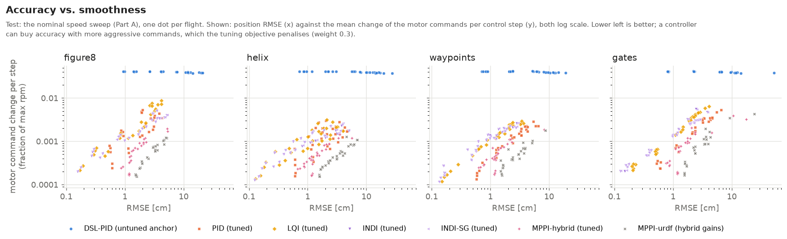
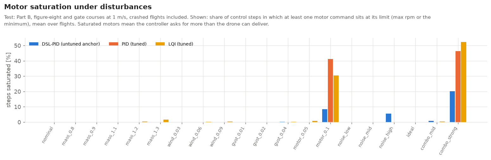

# Subproject 1 – Control

**Which controller follows a given path most accurately and most robustly when the world doesn't match the model?**

Part of [dronelab](../../README.md). All controllers fly the same randomised courses under the same disturbances and are tuned with the same fixed protocol:

| Stage | Methods | Status |
|---|---|---|
| R1 | cascaded PID (reference: gym-pybullet-drones `DSLPIDControl` [1]), own PID, LQI – tuned and benchmarked in the `real` world | done |
| R2 | INDI (incremental nonlinear dynamic inversion) | tuned (J 0.70 on validation), benchmark next |
| R3 | learned controller: PPO policy (collective thrust + body rates) | planned |
| R4 | sampling MPC (MPPI) with the learned dynamics model from subproject 2 | tuned, benchmark next |

Disturbances: mass change (payload), constant wind + gusts, motor lag, sensor noise, drag + ground effect, combinations.

## Architecture

```
controllers (PID / LQR / ...) ──act(state, ref)──►  Backend interface  ◄── PyBullet (gym-pybullet-drones)
        ▲                                                │
        └──────── courses: reference(t) ◄── runner ──────┴──► metrics / plots / benchmark
```

Controllers live in `src/dronelab/control/`, the shared simulator backend, courses, disturbances and evaluation in `src/dronelab/core/`. All controllers talk to a simulator-agnostic `Backend` (`reset`, `step(rpm)`, `observe`).

## Commands

Run from the repository root (installation: see the [main README](../../README.md#quickstart)).

```bash
python projects/control/scripts/run_course.py --config projects/control/configs/hover_pid.yaml
python projects/control/scripts/run_course.py --course gates --speed 1.5 --controller lqi --seed 1000
python projects/control/scripts/speed_test.py                     # simulator throughput on your machine

python projects/control/scripts/tune.py --controller pid lqi --trials 200            # fixed tuning protocol
python projects/control/scripts/benchmark.py --config projects/control/configs/benchmark/r1.yaml
python projects/control/scripts/analyze.py      # tables, plots and the results block of this README
python projects/control/scripts/plot_course.py --course gates --speed 1.5 --seed 1000 --controllers dsl_pid pid lqi   # 3D + side views
```

## Courses

Every course is generated deterministically from `(family, speed, seed)`:

| Family | Random parameters | Use |
|---|---|---|
| `hover` | target altitude 0.5–1.5 m (take-off from 0.1 m) | tuning + test |
| `figure8` | width, aspect ratio, rotation, altitude | tuning + test |
| `helix` | radius 0.5–2 m, 1–2 turns, climb | tuning + test |
| `waypoints` | 4–6 random points, ≥ 1 m apart | tuning + test |
| `gates` | 4–5 gates (0.5 × 0.5 m) as objects: spacing 1.2–1.8 m, lateral offset 0.2–1.2 m (usually alternating sides), height 0.7–1.6 m | **test only** (unseen family) |

The path is a cubic spline re-parametrised by arc length and flown at constant speed with a 2 m/s² ramp at start and end; the reference provides position, velocity and acceleration. A course is accepted only if it needs ≤ 80 % of the maximum thrust and ≤ 45° tilt (otherwise re-drawn, at most 50 times, else marked *infeasible* and not flown). A gate counts as passed only if the drone crosses the gate plane inside the opening in the flight direction. Path courses start exactly on the reference at rest, so the RMSE measures tracking, not the recovery from a random start offset.

## Metrics

Success rate (no crash, inside the arena, tilt < 80°) and – over successful flights – position RMSE, max error, steady-state error, settling time, IAE / ISE / ITAE, control effort, command smoothness, gates passed and controller compute time per step.

## Simulated world

| World | Contents | Used for |
|---|---|---|
| `ideal` | gym-pybullet-drones without aerodynamics, instant motors – identical to the textbook model (thrust ∝ rpm²) | cross-check scenario in the benchmark; the first R1 run (incl. LQR) is in the git history |
| `real` | PyBullet rotor drag + ground effect + downwash, first-order motor lag τ = 20 ms, plus three extra effects | default: R1 results below, R2–R4, all other subprojects |

The extra effects of the `real` world (`src/dronelab/core/world.py`, `AeroConfig`) are physically motivated but their coefficients are **assumptions** sized for the Crazyflie, so that each effect is noticeable at 3 m/s while nominal courses stay flyable:

| Effect | Model | Size |
|---|---|---|
| Quadratic body drag | F = −½ ρ C_d A \|v\| v, C_d A = 1·10⁻³ m² | 5.5 mN at 3 m/s (PyBullet's linear rotor drag: 16.7 mN) |
| Axial inflow | T_i = k_F Ω_i² (1 − 0.3 · v_ax,i / v_h), v_h = 4.0 m/s (momentum theory), v_ax,i includes the rotation | −7.7 % thrust when climbing at 1 m/s; damps roll and pitch rates |
| Blade flapping | M = −2.5·10⁻⁸ · ΣΩ · (e_z × v_⊥) | nose-up, 5.5 % of the maximum roll torque at 3 m/s |

With these effects the default LQR tracks 2–4× worse than in the ideal world (reference scales below), without crashing.

## Tuning and evaluation protocol

Published comparisons often pit a carefully designed method against a PID baseline whose tuning is not reported. Here every tunable controller gets **the same, fixed budget and objective**:

* **Objective** `J = mean_f(RMSE_f / RMSE_ref,f) + 0.3 · mean_f(smooth_f / smooth_ref,f) + 1.0 · crash rate`, nominal conditions only. Each course family f is normalised by fixed reference scales (default LQR), so hover take-off and path tracking count equally; *smooth* is the mean motor-command change per step, so overly aggressive gains are penalised (10 % smoother ≙ 3 % more error).
* **Optuna TPE**, 200 trials × 8 episodes (2 per family hover / figure8 / helix / waypoints, speed U(0.25, 1.5) m/s, tuning seeds 0–99). Each parameter is searched log-uniformly within ×/÷ 5 of its hand-set default (×/÷ 10 for integral gains); trial 0 is the default.
* **Selection**: the best 5 trials are re-flown on 40 validation episodes (seeds 100–199); the best on validation wins – this guards against lucky trials.
* **Anchor**: the original `DSLPIDControl` of gym-pybullet-drones [1] is *not* tuned. If the tuned own PID were worse than this anchor, the tuning would be broken.
* **Test**: frozen controllers on seeds 1000+ that were never used before. All controllers fly exactly the same courses, start states, wind directions and noise realisations, so results are compared pairwise (Wilcoxon signed-rank).
* For comparison: Madebo et al. [2] tune their controller with PSO, 20 particles × 30 iterations = 600 evaluations.

R1 benchmark (5 test seeds, `real` world): **Part A** – speed sweep 0.25 / 0.5 / 1 / 1.5 m/s and *extrapolation* to 2 / 3 m/s on figure8, helix, waypoints, gates (+ hover); **Part B** – 20 disturbance scenarios (mass 0.8–1.3×, constant wind 0.03–0.09 N, gusts, motor lag 50 / 100 ms instead of the world's 20 ms, sensor noise, the `ideal` world as cross-check, two combinations) on hover, figure8 and gates at 1 m/s.

LQR is not part of R1 in the `real` world. To save tuning time (~1.5 CPU-h per controller) only PID and LQI were re-tuned: in the first, ideal-world run LQR was as accurate as LQI but clearly less robust, because it has no integral action.

## Results (R1)

**Key findings (`real` world):**

* **LQI is the most accurate controller at every speed:** 1.3 cm median RMSE at 1 m/s and 3.5 cm at 3 m/s, against 2.2 / 5.1 cm for the tuned PID. Paired on the same flights, LQI beats PID in 87 % of cases. The untuned DSL-PID anchor reaches 6.6 cm at 1 m/s and survives only 20 % of the flights at 3 m/s.
* **The model gap costs accuracy:** in the ideal world the same controllers tracked at ~0.6 cm at 1 m/s (git history); with the extra aerodynamics and the motor lag it is 2–4× more.
* **The integrator decides the robustness:** under constant wind (0.09 N) LQI stays at 4.2 cm on figure-eights, PID degrades to 15.8 cm (×8); with 30 % extra mass 6.3 against 12.1 cm.
* **Motor lag is the hard limit:** 50 ms costs almost nothing, at 100 ms no controller finishes a figure-eight or gate course, and the strong combination is flown by nobody.



<!-- STAGE1-RESULTS:START -->
### Tuning (validation set, 40 episodes, seeds 100–139)

| Controller | Trials | J default | J tuned | mean RMSE [cm] | CPU-h |
|---|---|---|---|---|---|
| PID | 200 | 2.7098 | 0.9206 | 14.3 → 6.1 | 1.40 |
| LQI | 200 | 1.1292 | 0.8021 | 6.8 → 5.6 | 1.52 |
| INDI | 200 | 1.1485 | 0.7026 | 7.9 → 5.3 | 1.49 |
| INDI-SG | 200 | 1.1617 | 0.7068 | 8.0 → 5.4 | 1.81 |
| MPPI-hybrid | 80 | 0.7813 | 0.6517 | 7.2 → 6.1 | 17.40 |

Tuning convergence – PID: best J 1.088, 3.7 % gained in the second half; LQI: best J 0.902, 2.7 % gained in the second half; INDI: best J 0.791, 1.5 % gained in the second half; INDI-SG: best J 0.794, 2.2 % gained in the second half; MPPI-hybrid: best J 0.753, 2.7 % gained in the second half.



### Part A – speed sweep (nominal)

Median position RMSE [cm] of successful flights / success rate, over 4 families × 5 seeds. Speeds above 1.5 m/s are outside the tuning range.

| Controller | 0.25 m/s | 0.5 m/s | 1 m/s | 1.5 m/s | 2 m/s | 3 m/s |
|---|---|---|---|---|---|---|
| DSL-PID (untuned anchor) | 0.8 / 100 % | 2.3 / 100 % | 6.6 / 100 % | 11.4 / 100 % | 15.0 / 85 % | 39.8 / 20 % |
| PID (tuned) | 0.6 / 100 % | 1.2 / 100 % | 2.2 / 100 % | 3.1 / 100 % | 3.9 / 100 % | 5.1 / 100 % |
| LQI (tuned) | 0.2 / 100 % | 0.5 / 100 % | 1.3 / 100 % | 1.9 / 100 % | 2.3 / 100 % | 3.5 / 100 % |
| INDI (tuned) | 0.2 / 100 % | 0.4 / 100 % | 1.1 / 100 % | 1.9 / 100 % | 2.1 / 100 % | 3.1 / 100 % |
| INDI-SG (tuned) | 0.2 / 100 % | 0.4 / 100 % | 1.1 / 100 % | 1.8 / 100 % | 2.1 / 100 % | 3.2 / 100 % |
| MPPI-hybrid (tuned) | 1.2 / 100 % | 0.9 / 100 % | 1.2 / 100 % | 1.5 / 100 % | 2.0 / 100 % | 2.8 / 100 % |
| MPPI-urdf (hybrid gains) | 1.6 / 100 % | 1.7 / 100 % | 2.4 / 100 % | 3.3 / 100 % | 4.1 / 100 % | 6.5 / 100 % |

Infeasible courses (rejected by the thrust/tilt check, not flown): 3 m/s: 10.

Gate course – all gates passed (successful flights): DSL-PID 96 %; PID 100 %; LQI 100 %; INDI 100 %; INDI-SG 100 %; MPPI-hybrid 100 %; MPPI-urdf 100 %.


### Accuracy vs. smoothness (Part A, one dot per flight)

Lower left is better. A controller can buy accuracy with more aggressive motor commands; the tuning objective weighs this trade-off (w_s = 0.3).



### Error vs. required acceleration (per control step)

Every control step of the nominal speed sweep is sorted by the reference acceleration at that moment (straights ≈ 0, tight turns and braking > 4 m/s²). Bars: median error, whiskers: interquartile range.


### Part B – disturbances (1 m/s), per course family

Success rate and median RMSE [cm] of successful flights; in brackets the RMSE relative to the nominal scenario of the same family (1.0 = no degradation). Hover includes the take-off from 0.1 m, so its RMSE is an order of magnitude larger.

<details><summary><b>hover</b></summary>

| Scenario | DSL-PID | PID | LQI | INDI | INDI-SG | MPPI-hybrid | MPPI-urdf |
|---|---|---|---|---|---|---|---|
| nominal | 100 %, 14.6 (1.00) | 100 %, 14.7 (1.00) | 100 %, 15.3 (1.00) | 100 %, 14.5 (1.00) | 100 %, 15.3 (1.00) | 100 %, 17.4 (1.00) | 100 %, 17.3 (1.00) |
| mass_0.8 | 100 %, 14.2 (0.97) | 100 %, 16.3 (1.11) | 100 %, 15.0 (0.98) | 100 %, 14.3 (0.99) | 100 %, 14.7 (0.96) | 100 %, 15.5 (0.89) | 100 %, 15.6 (0.90) |
| mass_0.9 | 100 %, 14.3 (0.98) | 100 %, 15.1 (1.03) | 100 %, 15.0 (0.98) | 100 %, 14.4 (0.99) | 100 %, 15.0 (0.98) | 100 %, 16.4 (0.95) | 100 %, 16.4 (0.95) |
| mass_1.1 | 100 %, 15.3 (1.04) | 100 %, 15.2 (1.03) | 100 %, 15.8 (1.03) | 100 %, 14.8 (1.02) | 100 %, 15.6 (1.02) | 100 %, 18.6 (1.07) | 100 %, 18.6 (1.08) |
| mass_1.2 | 100 %, 16.1 (1.10) | 100 %, 16.4 (1.12) | 100 %, 16.5 (1.08) | 100 %, 15.2 (1.04) | 100 %, 15.9 (1.04) | 100 %, 20.5 (1.18) | 100 %, 20.5 (1.18) |
| mass_1.3 | 100 %, 17.2 (1.18) | 100 %, 18.3 (1.24) | 100 %, 17.4 (1.13) | 100 %, 15.7 (1.08) | 100 %, 16.2 (1.06) | 100 %, 23.1 (1.33) | 100 %, 23.2 (1.34) |
| wind_0.03 | 100 %, 15.5 (1.06) | 100 %, 15.5 (1.06) | 100 %, 15.4 (1.00) | 100 %, 14.5 (1.00) | 100 %, 15.3 (1.00) | 100 %, 17.4 (1.00) | 100 %, 17.4 (1.01) |
| wind_0.06 | 100 %, 17.8 (1.21) | 100 %, 17.8 (1.21) | 100 %, 15.5 (1.01) | 100 %, 14.5 (1.00) | 100 %, 15.3 (1.00) | 100 %, 18.3 (1.06) | 100 %, 18.2 (1.05) |
| wind_0.09 | 100 %, 21.0 (1.44) | 100 %, 21.1 (1.43) | 100 %, 15.6 (1.02) | 100 %, 14.5 (1.00) | 100 %, 15.3 (1.00) | 100 %, 24.5 (1.41) | 100 %, 24.1 (1.39) |
| gust_0.01 | 100 %, 14.9 (1.02) | 100 %, 14.8 (1.01) | 100 %, 15.4 (1.00) | 100 %, 14.5 (1.00) | 100 %, 15.3 (1.00) | 100 %, 17.2 (0.99) | 100 %, 17.2 (0.99) |
| gust_0.02 | 100 %, 15.7 (1.07) | 100 %, 15.5 (1.05) | 100 %, 15.6 (1.02) | 100 %, 14.5 (1.00) | 100 %, 15.3 (1.00) | 100 %, 17.6 (1.01) | 100 %, 17.5 (1.01) |
| gust_0.04 | 100 %, 18.4 (1.25) | 100 %, 18.1 (1.23) | 100 %, 16.5 (1.08) | 100 %, 14.6 (1.00) | 100 %, 15.6 (1.02) | 100 %, 24.4 (1.40) | 100 %, 24.6 (1.42) |
| motor_0.05 | 100 %, 15.1 (1.03) | 100 %, 15.1 (1.03) | 100 %, 15.7 (1.03) | 100 %, 15.0 (1.03) | 100 %, 15.4 (1.00) | 100 %, 17.8 (1.03) | 100 %, 17.8 (1.03) |
| motor_0.1 | 100 %, 15.6 (1.06) | 100 %, 15.7 (1.07) | 100 %, 16.3 (1.06) | 100 %, 15.6 (1.07) | 100 %, 15.5 (1.01) | 100 %, 18.4 (1.06) | 100 %, 18.4 (1.07) |
| noise_low | 100 %, 14.7 (1.00) | 100 %, 14.7 (1.00) | 100 %, 15.3 (1.00) | 100 %, 14.6 (1.00) | 100 %, 15.3 (1.00) | 100 %, 17.4 (1.00) | 100 %, 17.3 (1.00) |
| noise_mid | 100 %, 14.9 (1.02) | 100 %, 14.7 (1.00) | 100 %, 15.3 (1.00) | 100 %, 14.6 (1.01) | 100 %, 15.2 (1.00) | 100 %, 17.6 (1.01) | 100 %, 17.7 (1.02) |
| noise_high | 0 %, – | 100 %, 14.7 (1.00) | 100 %, 15.3 (1.00) | 100 %, 15.2 (1.04) | 100 %, 15.2 (0.99) | 100 %, 17.8 (1.02) | 100 %, 18.2 (1.05) |
| ideal | 100 %, 14.2 (0.97) | 100 %, 14.1 (0.96) | 100 %, 14.9 (0.97) | 100 %, 14.4 (0.99) | 100 %, 15.1 (0.98) | 100 %, 17.1 (0.99) | 100 %, 17.1 (0.99) |
| combo_mid | 100 %, 19.6 (1.34) | 100 %, 19.1 (1.30) | 100 %, 16.1 (1.05) | 100 %, 14.9 (1.03) | 100 %, 15.7 (1.02) | 100 %, 23.4 (1.35) | 100 %, 24.9 (1.44) |
| combo_strong | 0 %, – | 0 %, – | 0 %, – | 0 %, – | 0 %, – | 60 %, 49.9 (2.87) | 80 %, 51.0 (2.95) |

</details>

<details><summary><b>figure8</b></summary>

| Scenario | DSL-PID | PID | LQI | INDI | INDI-SG | MPPI-hybrid | MPPI-urdf |
|---|---|---|---|---|---|---|---|
| nominal | 100 %, 10.7 (1.00) | 100 %, 1.9 (1.00) | 100 %, 2.6 (1.00) | 100 %, 3.0 (1.00) | 100 %, 2.9 (1.00) | 100 %, 1.9 (1.00) | 100 %, 3.0 (1.00) |
| mass_0.8 | 100 %, 9.3 (0.87) | 100 %, 7.6 (3.93) | 100 %, 4.3 (1.61) | 100 %, 2.3 (0.77) | 100 %, 2.3 (0.78) | 100 %, 4.8 (2.54) | 100 %, 5.2 (1.75) |
| mass_0.9 | 100 %, 9.9 (0.92) | 100 %, 4.0 (2.08) | 100 %, 3.1 (1.16) | 100 %, 2.6 (0.88) | 100 %, 2.5 (0.87) | 100 %, 2.3 (1.21) | 100 %, 3.4 (1.14) |
| mass_1.1 | 100 %, 12.0 (1.12) | 100 %, 4.6 (2.37) | 100 %, 3.3 (1.26) | 100 %, 3.3 (1.12) | 100 %, 3.4 (1.16) | 100 %, 3.4 (1.79) | 100 %, 3.2 (1.06) |
| mass_1.2 | 100 %, 13.7 (1.28) | 100 %, 8.3 (4.28) | 100 %, 4.7 (1.76) | 100 %, 3.7 (1.25) | 100 %, 3.9 (1.33) | 100 %, 11.9 (6.28) | 100 %, 9.3 (3.11) |
| mass_1.3 | 100 %, 15.6 (1.45) | 100 %, 12.1 (6.24) | 100 %, 6.3 (2.37) | 100 %, 4.1 (1.37) | 100 %, 4.4 (1.52) | 100 %, 30.0 (15.77) | 100 %, 27.2 (9.13) |
| wind_0.03 | 100 %, 12.0 (1.12) | 100 %, 5.5 (2.83) | 100 %, 2.9 (1.11) | 100 %, 3.0 (1.00) | 100 %, 2.9 (1.01) | 100 %, 2.3 (1.21) | 100 %, 3.3 (1.12) |
| wind_0.06 | 100 %, 14.6 (1.36) | 100 %, 10.5 (5.45) | 100 %, 3.5 (1.33) | 100 %, 3.0 (1.01) | 100 %, 3.0 (1.05) | 100 %, 5.8 (3.08) | 100 %, 4.8 (1.60) |
| wind_0.09 | 100 %, 18.5 (1.72) | 100 %, 15.8 (8.19) | 100 %, 4.2 (1.60) | 100 %, 3.1 (1.04) | 100 %, 3.3 (1.13) | 100 %, 14.7 (7.74) | 100 %, 16.5 (5.53) |
| gust_0.01 | 100 %, 10.9 (1.01) | 100 %, 3.0 (1.55) | 100 %, 3.0 (1.15) | 100 %, 2.9 (0.99) | 100 %, 2.9 (1.00) | 100 %, 2.6 (1.38) | 100 %, 3.3 (1.11) |
| gust_0.02 | 100 %, 11.0 (1.03) | 100 %, 4.8 (2.50) | 100 %, 4.1 (1.55) | 100 %, 3.0 (1.00) | 100 %, 3.1 (1.07) | 100 %, 6.3 (3.31) | 100 %, 6.6 (2.20) |
| gust_0.04 | 100 %, 14.7 (1.37) | 100 %, 9.2 (4.78) | 100 %, 6.2 (2.33) | 100 %, 3.4 (1.13) | 100 %, 4.4 (1.50) | 100 %, 22.9 (12.06) | 100 %, 20.4 (6.85) |
| motor_0.05 | 100 %, 11.5 (1.07) | 100 %, 1.9 (0.98) | 100 %, 3.2 (1.21) | 100 %, 2.9 (0.99) | 100 %, 2.9 (0.99) | 100 %, 1.9 (1.00) | 100 %, 3.0 (1.01) |
| motor_0.1 | 0 %, – | 0 %, – | 0 %, – | 0 %, – | 0 %, – | 100 %, 2.2 (1.16) | 100 %, 3.2 (1.08) |
| noise_low | 100 %, 10.8 (1.01) | 100 %, 1.9 (0.99) | 100 %, 2.6 (0.98) | 100 %, 3.0 (1.00) | 100 %, 2.9 (0.99) | 100 %, 1.9 (1.01) | 100 %, 3.0 (1.02) |
| noise_mid | 80 %, 11.4 (1.06) | 100 %, 2.0 (1.01) | 100 %, 2.5 (0.96) | 100 %, 3.3 (1.11) | 100 %, 2.9 (1.00) | 100 %, 4.1 (2.18) | 100 %, 5.2 (1.73) |
| noise_high | 0 %, – | 100 %, 2.2 (1.12) | 100 %, 2.5 (0.95) | 100 %, 5.6 (1.88) | 100 %, 3.1 (1.07) | 100 %, 5.6 (2.94) | 100 %, 5.7 (1.93) |
| ideal | 100 %, 11.8 (1.10) | 100 %, 2.5 (1.31) | 100 %, 3.2 (1.21) | 100 %, 3.0 (1.03) | 100 %, 3.0 (1.05) | 100 %, 1.8 (0.97) | 100 %, 2.0 (0.66) |
| combo_mid | 80 %, 16.2 (1.51) | 100 %, 12.0 (6.18) | 100 %, 4.6 (1.73) | 100 %, 3.9 (1.32) | 100 %, 4.0 (1.39) | 100 %, 20.7 (10.87) | 100 %, 20.2 (6.76) |
| combo_strong | 0 %, – | 0 %, – | 0 %, – | 0 %, – | 0 %, – | 60 %, 52.4 (27.58) | 80 %, 42.5 (14.25) |

</details>

<details><summary><b>gates</b></summary>

| Scenario | DSL-PID | PID | LQI | INDI | INDI-SG | MPPI-hybrid | MPPI-urdf |
|---|---|---|---|---|---|---|---|
| nominal | 100 %, 6.6 (1.00) | 100 %, 2.3 (1.00) | 100 %, 1.4 (1.00) | 100 %, 1.1 (1.00) | 100 %, 1.1 (1.00) | 100 %, 1.2 (1.00) | 100 %, 2.4 (1.00) |
| mass_0.8 | 100 %, 6.4 (0.98) | 100 %, 6.3 (2.69) | 100 %, 3.4 (2.48) | 100 %, 0.8 (0.73) | 100 %, 0.8 (0.71) | 100 %, 3.4 (2.74) | 100 %, 3.8 (1.60) |
| mass_0.9 | 100 %, 6.1 (0.94) | 100 %, 3.6 (1.53) | 100 %, 2.0 (1.50) | 100 %, 1.0 (0.86) | 100 %, 0.9 (0.81) | 100 %, 1.5 (1.25) | 100 %, 2.6 (1.10) |
| mass_1.1 | 100 %, 7.4 (1.13) | 100 %, 4.0 (1.73) | 100 %, 2.1 (1.57) | 100 %, 1.3 (1.15) | 100 %, 1.4 (1.25) | 100 %, 1.7 (1.37) | 100 %, 2.5 (1.04) |
| mass_1.2 | 100 %, 8.6 (1.31) | 100 %, 6.8 (2.92) | 100 %, 3.5 (2.57) | 100 %, 1.5 (1.31) | 100 %, 1.7 (1.50) | 100 %, 4.2 (3.42) | 100 %, 4.3 (1.82) |
| mass_1.3 | 100 %, 10.3 (1.56) | 100 %, 9.8 (4.22) | 100 %, 5.0 (3.68) | 100 %, 1.7 (1.47) | 100 %, 2.0 (1.79) | 100 %, 16.5 (13.41) | 100 %, 17.0 (7.15) |
| wind_0.03 | 100 %, 7.3 (1.12) | 100 %, 4.8 (2.06) | 100 %, 1.5 (1.07) | 100 %, 1.1 (1.01) | 100 %, 1.2 (1.03) | 100 %, 1.8 (1.45) | 100 %, 2.6 (1.08) |
| wind_0.06 | 100 %, 9.6 (1.46) | 100 %, 9.3 (4.00) | 100 %, 1.9 (1.39) | 100 %, 1.2 (1.05) | 100 %, 1.3 (1.14) | 100 %, 3.2 (2.59) | 100 %, 3.5 (1.48) |
| wind_0.09 | 100 %, 12.9 (1.97) | 100 %, 14.4 (6.16) | 100 %, 2.4 (1.81) | 100 %, 1.3 (1.13) | 100 %, 1.5 (1.32) | 100 %, 6.9 (5.59) | 100 %, 7.3 (3.06) |
| gust_0.01 | 100 %, 7.0 (1.07) | 100 %, 3.4 (1.44) | 100 %, 2.1 (1.58) | 100 %, 1.2 (1.05) | 100 %, 1.5 (1.29) | 100 %, 2.3 (1.89) | 100 %, 3.0 (1.28) |
| gust_0.02 | 100 %, 8.5 (1.29) | 100 %, 5.2 (2.24) | 100 %, 3.6 (2.65) | 100 %, 1.6 (1.38) | 100 %, 2.1 (1.89) | 100 %, 5.1 (4.12) | 100 %, 5.4 (2.29) |
| gust_0.04 | 100 %, 12.8 (1.95) | 100 %, 10.2 (4.40) | 100 %, 6.8 (5.02) | 100 %, 2.6 (2.29) | 100 %, 3.9 (3.49) | 100 %, 15.2 (12.30) | 100 %, 22.7 (9.58) |
| motor_0.05 | 100 %, 6.7 (1.02) | 100 %, 2.3 (0.98) | 100 %, 1.3 (1.00) | 100 %, 1.1 (1.00) | 100 %, 1.1 (1.00) | 100 %, 1.2 (1.01) | 100 %, 2.4 (1.01) |
| motor_0.1 | 0 %, – | 0 %, – | 0 %, – | 0 %, – | 0 %, – | 100 %, 1.4 (1.16) | 100 %, 2.4 (1.00) |
| noise_low | 100 %, 7.2 (1.10) | 100 %, 2.4 (1.02) | 100 %, 1.4 (1.04) | 100 %, 1.2 (1.05) | 100 %, 1.2 (1.03) | 100 %, 1.4 (1.16) | 100 %, 2.4 (1.01) |
| noise_mid | 100 %, 8.8 (1.34) | 100 %, 2.4 (1.03) | 100 %, 1.5 (1.11) | 100 %, 1.9 (1.63) | 100 %, 1.3 (1.12) | 100 %, 4.6 (3.69) | 100 %, 6.0 (2.53) |
| noise_high | 0 %, – | 100 %, 2.5 (1.07) | 100 %, 1.7 (1.23) | 100 %, 4.8 (4.19) | 100 %, 1.7 (1.51) | 100 %, 8.3 (6.71) | 100 %, 9.0 (3.80) |
| ideal | 100 %, 6.1 (0.93) | 100 %, 1.0 (0.41) | 100 %, 1.4 (1.02) | 100 %, 1.2 (1.02) | 100 %, 1.1 (1.02) | 100 %, 1.7 (1.41) | 100 %, 1.2 (0.52) |
| combo_mid | 100 %, 13.3 (2.03) | 100 %, 11.3 (4.85) | 100 %, 3.6 (2.65) | 100 %, 2.2 (1.93) | 100 %, 2.5 (2.20) | 100 %, 14.2 (11.47) | 100 %, 12.8 (5.41) |
| combo_strong | 0 %, – | 0 %, – | 0 %, – | 0 %, – | 0 %, – | 60 %, 49.8 (40.34) | 60 %, 51.0 (21.49) |

</details>


Degradation curves (median, bars = interquartile range of the 5 seeds; missing points = no successful flight):


### Motor saturation

Share of control steps in which at least one motor command sits at its limit (max rpm, or the minimum: 0 rpm for own controllers, PWM floor ≈ 9 440 rpm for DSL-PID). Mean over flights; crashed flights included.

| Controller | 0.25 m/s | 0.5 m/s | 1 m/s | 1.5 m/s | 2 m/s | 3 m/s |
|---|---|---|---|---|---|---|
| DSL-PID | 0 % | 0 % | 0 % | 0 % | 1 % | 7 % |
| PID | 0 % | 0 % | 0 % | 0 % | 0 % | 0 % |
| LQI | 0 % | 0 % | 0 % | 0 % | 0 % | 0 % |

Nominal flights stay below the limits at every speed – the feasibility check admits only courses that need ≤ 80 % of the maximum thrust. Saturation appears under disturbances, above all with motor lag:



### Paired comparison (same course, seed and disturbance; both controllers finished)

Hover and path courses are tested separately because their RMSE scales differ.

| Courses | A vs B | n | median(RMSE_A − RMSE_B) [cm] | A better in | Wilcoxon p |
|---|---|---|---|---|---|
| hover | dsl_pid vs pid | 95 | -0.08 | 65 % | 1.2e-04 |
| hover | dsl_pid vs lqi | 95 | -0.37 | 69 % | 1.2e-01 |
| hover | dsl_pid vs indi | 95 | +0.38 | 27 % | 3.6e-10 |
| hover | dsl_pid vs indi_sg | 95 | -0.11 | 54 % | 6.1e-01 |
| hover | dsl_pid vs mppi_hybrid | 95 | -2.66 | 94 % | 3.5e-15 |
| hover | dsl_pid vs mppi_urdf | 95 | -2.65 | 95 % | 3.8e-15 |
| hover | pid vs lqi | 100 | -0.09 | 57 % | 2.8e-01 |
| hover | pid vs indi | 100 | +0.60 | 15 % | 4.2e-13 |
| hover | pid vs indi_sg | 100 | +0.07 | 47 % | 1.5e-02 |
| hover | pid vs mppi_hybrid | 100 | -2.62 | 90 % | 4.0e-14 |
| hover | pid vs mppi_urdf | 100 | -2.63 | 90 % | 3.8e-14 |
| hover | lqi vs indi | 100 | +0.88 | 7 % | 3.4e-16 |
| hover | lqi vs indi_sg | 100 | +0.24 | 28 % | 2.2e-06 |
| hover | lqi vs mppi_hybrid | 100 | -2.30 | 99 % | 4.4e-18 |
| hover | lqi vs mppi_urdf | 100 | -2.30 | 99 % | 4.3e-18 |
| hover | indi vs indi_sg | 100 | -0.63 | 94 % | 2.0e-16 |
| hover | indi vs mppi_hybrid | 100 | -3.21 | 99 % | 4.0e-18 |
| hover | indi vs mppi_urdf | 100 | -3.22 | 99 % | 4.0e-18 |
| hover | indi_sg vs mppi_hybrid | 100 | -2.58 | 99 % | 4.0e-18 |
| hover | indi_sg vs mppi_urdf | 100 | -2.57 | 99 % | 4.0e-18 |
| hover | mppi_hybrid vs mppi_urdf | 102 | -0.01 | 53 % | 5.2e-01 |
| path courses | dsl_pid vs pid | 267 | +4.10 | 4 % | 5.7e-44 |
| path courses | dsl_pid vs lqi | 267 | +6.47 | 0 % | 1.5e-45 |
| path courses | dsl_pid vs indi | 267 | +7.29 | 0 % | 1.5e-45 |
| path courses | dsl_pid vs indi_sg | 267 | +7.27 | 0 % | 1.5e-45 |
| path courses | dsl_pid vs mppi_hybrid | 267 | +5.21 | 18 % | 2.9e-25 |
| path courses | dsl_pid vs mppi_urdf | 267 | +4.33 | 18 % | 2.7e-23 |
| path courses | pid vs lqi | 290 | +1.00 | 13 % | 7.9e-38 |
| path courses | pid vs indi | 290 | +1.27 | 17 % | 5.2e-30 |
| path courses | pid vs indi_sg | 290 | +1.23 | 14 % | 1.0e-35 |
| path courses | pid vs mppi_hybrid | 290 | +0.57 | 39 % | 2.0e-02 |
| path courses | pid vs mppi_urdf | 290 | -0.41 | 65 % | 2.9e-06 |
| path courses | lqi vs indi | 290 | +0.26 | 18 % | 2.3e-19 |
| path courses | lqi vs indi_sg | 290 | +0.26 | 15 % | 7.5e-28 |
| path courses | lqi vs mppi_hybrid | 290 | -0.36 | 65 % | 3.5e-13 |
| path courses | lqi vs mppi_urdf | 290 | -1.36 | 95 % | 8.1e-47 |
| path courses | indi vs indi_sg | 290 | -0.00 | 52 % | 1.9e-02 |
| path courses | indi vs mppi_hybrid | 290 | -0.61 | 78 % | 3.6e-23 |
| path courses | indi vs mppi_urdf | 290 | -1.58 | 95 % | 2.5e-47 |
| path courses | indi_sg vs mppi_hybrid | 290 | -0.65 | 79 % | 3.1e-25 |
| path courses | indi_sg vs mppi_urdf | 290 | -1.58 | 96 % | 4.2e-48 |
| path courses | mppi_hybrid vs mppi_urdf | 305 | -0.89 | 86 % | 1.4e-25 |

Controller compute time per step (median): dsl_pid 1.244 ms, pid 0.731 ms, lqi 0.303 ms, indi 0.687 ms, indi_sg 0.637 ms, mppi_hybrid 78.483 ms, mppi_urdf 34.481 ms.

_2975 episodes, git 15c6cca-dirty, config 5aad03090e_
<!-- STAGE1-RESULTS:END -->

## R4 – MPPI with the learned surrogate (in progress)

`src/dronelab/control/mppi.py`. Every control step K = 512 perturbed sequences of (collective thrust, desired body rates) over H = 20 steps (0.42 s, the horizon the surrogate was trained on) are rolled out with a model from the [surrogate subproject](../surrogate/README.md), scored against the reference preview and averaged with weights exp(−J/λ); the first command is applied, the sequence is shifted and reused (warm start). Variants: `mppi_hybrid` (`phys+mlp`, the learned residual model) and `mppi_urdf` (data-sheet physics, no learning; benchmarked with the hybrid gains, not tuned on its own).

| Part | Design |
|---|---|
| inputs | thrust + body rates; a fixed P rate loop (the tuned PID's rate gains) runs inside every rollout step and on the measured rates. Sampling the torques directly was tried first and tracked 5–10× worse than LQI |
| model | surrogate rollout with an 8-step history (motor state included), physics step in numba (`surrogate/fast.py`): ~70 ms per control step for `phys+mlp`, ~9 ms for URDF physics on one CPU core |
| disturbance | one-step prediction error, smoothed by an EMA with time constant τ_d (tuned), added to every predicted step (offset-free MPC); only in the prediction, not on the command |
| cost | position, velocity, tilt (1 − cos), yaw, body rates, command change, terminal weight; crash penalty 10⁴ |
| reference candidate | a geometric PD law (thrust and rates from the desired acceleration) gives one extra sample plus 1/16 of the samples around it |
| smoothing | Savitzky-Golay over the last 4 applied + the 20 planned commands |

**Why the candidate and the smoothing.** Plain MPPI with hand-set defaults reached J = 1.41 against 0.90 for LQI on the tuning episodes, and a 30-trial pilot study improved it only to 1.39. Diagnosis on one hover and one figure-eight episode: (1) on take-off the nominal thrust can only move by about σ per step, so MPPI climbed with ≤ 0.31 N where LQI used 0.57 N (38 vs 25 cm RMSE); the same slow build-up gave a 6 cm error peak at the start of path courses; (2) the weighted noise average makes the commands jitter (1.8× LQI's command change on the tuning episodes). In between, on the figure-eight, MPPI tracked *better* than LQI (0.3–0.8 vs 1–1.5 cm) – the model was not the problem. Both additions together gave J = 0.89 with the defaults; plots in `results/tuning_real/mppi_hybrid_pilot1/`.

**Tuning** (same objective, episodes and validation as R1; 11 parameters, w_pos fixed because the cost is normalised; **80 instead of 200 trials** because one trial takes ~4.5 min on the laptop – 17 CPU-h in total vs 1.5 for LQI):

| Controller | J validation | rmse_rel | smooth_rel | crash rate |
|---|---:|---:|---:|---:|
| PID (tuned) | 0.921 | 0.611 | 1.03 | 0 |
| LQI (tuned) | 0.802 | **0.468** | 1.11 | 0 |
| MPPI hybrid, defaults | 0.781 | 0.638 | 0.48 | 0 |
| MPPI hybrid, tuned | **0.652** | 0.507 | **0.48** | 0 |
| MPPI hybrid, tuned, tilt cost relative to the reference (not kept) | 0.648 | 0.503 | 0.48 | 0 |
| reference candidate alone (geometric PD, untuned) | 2.344 | 2.185 | 0.53 | 0 |

MPPI wins on J through the command smoothness (less than half of LQI's command change); LQI is still ~8 % more accurate. The candidate alone tracks 4× worse – the gain comes from the optimisation over the learned model, not from the PD law it is seeded with (`results/mppi/ablation.md`). Measuring the tilt against the thrust direction the reference needs (as the attitude error of [3]) instead of against the vertical changed J by < 1 % (the tuned tilt weight is small) and was not kept.

**Comparison with published MPPI for quadrotors.** Minařík et al. [3] use the same interface (thrust + body rates) with a 1.5 s horizon of coarse 0.1 s steps and an analytic model, and report that MPPI loses to a geometric SE(3) controller in nominal tracking. Kotek et al. [4] show that modelling the low-level rate controller and the motors inside the rollout is the main nominal gain (here: the P rate loop in the rollout and the motor state in the surrogate) and add an L1 adaptive loop on the command; our disturbance estimate plays a similar role inside the prediction (ablation `_nodob` in the benchmark). Not taken over: longer horizons (the surrogate is trained at 48 Hz; 0.42 s suffice for the courses, a longer horizon would cost 1.5–2× compute), saturation handling inside the rollout like the real mixer (only matters at the motor limits – revisit if MPPI falls behind at 2–3 m/s), delay compensation (the simulation has no latency).

Next: benchmark `r1` with `mppi_hybrid` and `mppi_urdf` (Part A + B), ablations `mppi_hybrid_nodob` / `mppi_hybrid_cand` on Part B (`configs/benchmark/r1_mppi_ablation.yaml`), both without `--log-flights`.

## References

1. J. Panerati, H. Zheng, S. Zhou, J. Xu, A. Prorok, A. P. Schoellig, "Learning to Fly—a Gym Environment with PyBullet Physics for Reinforcement Learning of Multi-agent Quadcopter Control," *IEEE/RSJ International Conference on Intelligent Robots and Systems (IROS)*, 2021. [arXiv:2103.02142](https://arxiv.org/abs/2103.02142) · Code: [utiasDSL/gym-pybullet-drones](https://github.com/utiasDSL/gym-pybullet-drones)
2. M. M. Madebo, M. Y. Erten, H. Aydilek, "PSO-optimized physics-informed neural network-based fuzzy-sliding mode controller design for quadrotor altitude stabilization and trajectory tracking," *Ain Shams Engineering Journal*, vol. 17, art. 104312, 2026. [doi:10.1016/j.asej.2026.104312](https://doi.org/10.1016/j.asej.2026.104312)
3. M. Minařík, R. Pěnička, V. Vonásek, M. Saska, "Model Predictive Path Integral Control for Agile Unmanned Aerial Vehicles," *IEEE/RSJ International Conference on Intelligent Robots and Systems (IROS)*, 2024. [arXiv:2407.09812](https://arxiv.org/abs/2407.09812)
4. L. Kotek, O. Procházka, V. Vonásek, M. Saska, R. Pěnička, "L1-MPPI: L1 Adaptive Model Predictive Path Integral for Agile UAV Control," arXiv preprint, 2026. [arXiv:2609.38467](https://arxiv.org/abs/2609.38467)
