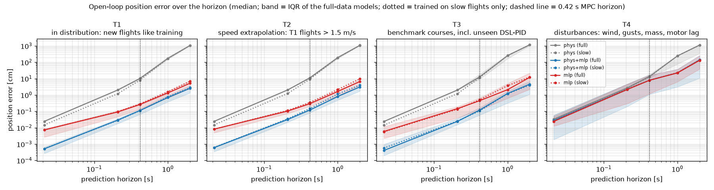
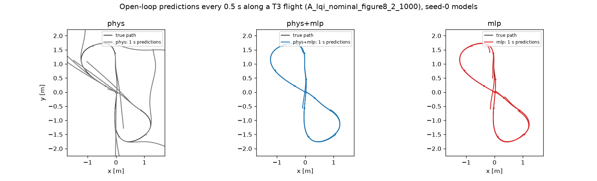
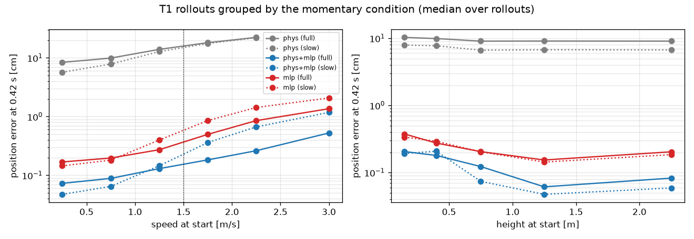
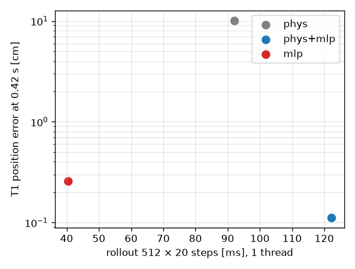
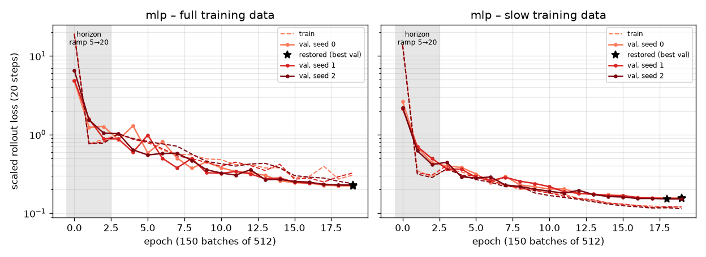

# Subproject 2 – Surrogate modelling

**How well does a learned model predict the dynamics of the drone – above all outside its training data (faster, other controllers, disturbed)?**

Part of [dronelab](../../README.md). Status: first round done (physics, physics + MLP, MLP). GRU variants and the controller-change test set T5 come later.

The model is meant for model-predictive control (subproject 1, R4) and gate flight with MPPI (subproject 3). It therefore runs at the control rate (48 Hz) and has to be accurate over an MPC horizon of 20 steps (0.42 s). It also has to be fast for batches of hundreds of command sequences.

## Setup

**World.** The data come from the `real` world of stage 0b, which adds three effects to PyBullet:

* PyBullet's own rotor drag, ground effect and downwash, plus a 20 ms first-order motor lag;
* quadratic body drag;
* thrust loss in axial inflow;
* a blade-flapping moment in forward flight.

The physics prior below only knows the standard model, so it has a real model gap that the network has to learn. This follows variant C of the plan.

**Task.** The model gets the state and the *commanded* rotor speeds and predicts the next state, 20.8 ms later.

* The state is height, velocity in the body frame, attitude and body rates.
* The actual rotor speeds are not given; a real Crazyflie does not measure them either.
* Position and attitude are integrated kinematically for every model.
* All models use the same batched torch interface, `Surrogate.rollout(pos, vel, rot, omega, u, warmup, horizon)`.

| Model | Physics | Network |
|---|---|---|
| `phys` | Rigid body. Mass and inertia from the URDF (weighed). Thrust k_F·Ω² and torque k_M·Ω², linear rotor drag ∝ ΣΩ·v (separate xy/z coefficients), first-order motor lag. **Learnable:** k_F, k_M, k_D,xy, k_D,z, τ. 5 physics substeps per control step. | – |
| `phys+mlp` | as `phys`, starts from the fitted `phys` | MLP 2 × 128 predicts a residual force and torque in the body frame from a window of the last k states and commands |
| `mlp` | – | MLP 2 × 128 predicts Δv (body) and Δω from the same window |

The ground effect is deliberately *not* in the prior.

**Data and test sets.** See [DATASETS.md](DATASETS.md).

* **Training:** 583 flights, about 750 k steps or 4.4 h of flight time. Half are excitation flights, half are course flights with a variable speed profile, flown alternately by the re-tuned PID and LQI.
* **Validation:** 98 flights. No disturbances in training or validation.

| Test set | Content | Question |
|---|---|---|
| T1 | new excitation and course flights (99 flights) | does the model learn? |
| T2 | T1 flights faster than 1.5 m/s (65 flights), tested against models trained only on flights ≤ 1.5 m/s | speed extrapolation |
| T3 | R1 benchmark part A: 5 families × 6 speeds up to 2 m/s, flown by DSL-PID, PID and LQI (345 flights) | MPC-like course flights, including a controller never seen in training |
| T4 | R1 benchmark part B: mass, wind, gusts, 50/100 ms motor lag, sensor noise, combinations (803 flights) | unknown conditions |

**Training.**

* Loss over open-loop rollouts with the recorded commands: 8 warm-up steps, then 20 predicted steps. The horizon ramps up from 5 steps over the first 3 epochs.
* The loss sums the position, velocity, attitude and body-rate errors, each scaled.
* Optimiser: Adam with a cosine learning-rate schedule. Early stopping on validation rollouts.
* `phys` is fitted first (10 epochs). The networks are trained for 20 epochs × 150 batches of 512, with 3 seeds each.
* History window, chosen on the validation loss: k = 4 for both networks. k = 1 fails for the pure MLP (validation loss 11.2 against 0.39), because without history it cannot tell how far the motors have spun up.
* Compute: the whole training stage took 2.4 h wall time on 2 cores, with 2 trainings in parallel, 1 thread each.

**Evaluation.**

* Open-loop rollouts start every 0.25 s along each test flight, with the recorded commands.
* Errors are taken after 1 step, 0.21 s, 0.42 s, 1 s and 2 s, and averaged per flight.
* Reported: median and IQR over flights. Networks are averaged over their 3 seeds. Paired Wilcoxon tests on the same flights.

## Results

Median position error [cm] / attitude error [°] at the MPC horizon (0.42 s), full training data:

| Test set | `phys` | `phys+mlp` | `mlp` |
|---|---|---|---|
| T1 in distribution | 10.1 / 28.6 | **0.11 / 0.2** | 0.26 / 0.4 |
| T2 faster than 1.5 m/s | 11.0 / 32.8 | **0.12 / 0.2** | 0.29 / 0.5 |
| T3 benchmark courses | 12.6 / 46.8 | **0.12 / 0.3** | 0.45 / 0.6 |
| T4 disturbances | 13.4 / 43.0 | 7.9 / 3.0 | 7.8 / 3.0 |

The seed spread of the network medians is ≤ 0.01 cm at 0.42 s. All horizons, velocity errors, IQRs and the per-scenario tables are in the [full report](results/report.md).



### 1. Physics + residual is the most accurate model, and the physics alone is not usable open-loop

* **The hybrid beats the pure MLP on every T1–T3 flight.** Its error at 0.42 s is 2–3 times smaller: the median ratio is 0.46 on T1 and 0.32 on T3, with p < 10⁻¹¹ (Wilcoxon). The gap stays the same over the whole horizon, at 2.5 cm against 5.2 cm after 2 s on T1.
* **The physics model alone tilts away within a fraction of a second.** It knows nothing about the flapping moment, which pitches the nose up in forward flight. The controller compensates for this moment all the time, so when the recorded commands are replayed open-loop, the model rolls off.
  * The attitude error reaches about 30° after 0.42 s.
  * The position error reaches metres after 1 s.
  * The example below shows the same along a 2 m/s figure-eight: the 1 s predictions of `phys` fly off, while both networks stay on the path.



### 2. The fitted physics parameters

| parameter | PyBullet value | `phys` | physics part of `phys+mlp` (seed 0) |
|---|---|---|---|
| k_F | 3.16e-10 | 2.86e-10 (−9 %) | 3.13e-10 (−1 %) |
| k_M | 7.94e-12 | 7.84e-12 | 7.80e-12 |
| k_D,xy | 9.2e-7 | 2.1e-6 | 1.6e-6 |
| k_D,z | 1.0e-6 | 2.0e-6 | 2.9e-6 |
| τ motor | 20 ms | 16 ms | 19 ms |

**Inside the hybrid, the physics part recovers the true thrust coefficient and motor time constant.** The drag coefficients come out larger than PyBullet's. That is expected, because they also absorb the quadratic body drag of the real world.

**Fitted alone, `phys` lowers its thrust by 9 %.** Under the multi-step loss this is a compromise against the unmodelled pitch-up: less thrust means a tilted prediction drifts less sideways. The side effect is a constant downward error of about 0.9 m/s². This explains the uniform 2 cm error at 0.21 s on all test sets, and why `phys` looks *better* than the networks at 20–30 % extra mass (T4).

The `phys` baseline is therefore the best this prior can do under this loss, not the simulator's own parameters. With the true parameters it would still tilt by about 30° after 0.42 s.

### 3. Extrapolation to higher speed: the physics prior helps only partly

Trained only on flights ≤ 1.5 m/s, the models lose little on T2 at the MPC horizon:

| model | trained on all data | trained on slow flights only |
|---|---|---|
| `phys+mlp` | 0.12 cm | 0.15 cm |
| `mlp` | 0.29 cm | 0.35 cm |

Grouping the rollouts by the *momentary* speed shows more:

* **Hybrid:** the slow-trained model loses its advantage above 1.5 m/s. At 3 m/s it reaches 1.2 cm against 0.5 cm when trained on all data.
* **Pure MLP:** it degrades in the same way, from 1.4 to 2.1 cm.



Unlike in NeuroBEM [2], the prior does not carry the extrapolation here. The effects that grow with speed (flapping moment, axial inflow, quadratic drag) are exactly the ones the prior does not contain, so the residual has to extrapolate them in both models.

Near the ground (< 0.5 m) the errors of both networks are about twice as large as at 1–2 m. The ground effect is learned, but less precisely.

### 4. Another controller: the hybrid generalises better

DSL-PID never flew in the training data. On its T3 flights:

| model | other controllers | DSL-PID |
|---|---|---|
| `phys+mlp` | 0.08 cm | 0.15 cm |
| `mlp` | 0.17 cm | 0.64 cm (×3.8) |

DSL-PID commands differ more strongly from step to step, and the pure network meets inputs it has not seen. The physics part keeps the hybrid's response to the commands plausible.

### 5. Unknown disturbances: no model can predict them

On T4 both networks fall to about 8 cm at 0.42 s and are equal: the hybrid is better on only 30 % of the flights, with a median ratio of 1.01.

* **Unknown forces:** wind, gusts and wrong mass are forces the model cannot see in its inputs, so the error grows with their strength.
  * Wind 0.03/0.06/0.09 N: 8 / 16 / 24 cm.
  * Mass ×0.8: 15 cm.
* **Longer motor lag** (50/100 ms) costs surprisingly little: 1.3–1.8 cm.
* **Sensor noise:** the noise scenarios match nominal, because the logs hold the true states.

For model-based control this means the model needs online adaptation or an integral or disturbance estimate (R4), not more training data.

### 6. Compute

| model | parameters | rollout 512 × 20 steps (1 thread) | training per seed |
|---|---|---|---|
| `phys` | 5 | 92 ms | 9 min |
| `phys+mlp` | 26.6 k | 122 ms | 27 min |
| `mlp` | 24.6 k | **40 ms** | 8 min |

The 5 physics substeps make up most of the cost of `phys` and `phys+mlp`.

At 48 Hz a control step has 21 ms, so neither model is real-time for MPPI with 512 samples in eager PyTorch on this CPU. R4 has to reduce samples or substeps, or compile the rollout. Until then the trade-off stands at:

* `phys+mlp`: 2–4 times more accurate;
* `mlp`: 3 times faster.



## Limitations

* **Simulated data.** The model gap is designed by hand: the world adds three effects, and the prior ignores them. It is a controlled test of the method, not evidence about a real Crazyflie.
* **Open-loop errors beyond 1 s say little.** The open-loop dynamics are unstable, so errors there are dominated by attitude drift. The relevant horizon for MPC is 0.42 s.
* **Short training budget.** It was fitted to the 2-core CPU: 20 epochs, no tuning of width or learning rate, only the window was searched. Longer training would probably lower the network errors further: the validation loss of the MLP still falls at the last epoch, and the best state is always one of the last two epochs (figure below). It would not change the ranking: the seed spread is tiny.

  
* **`phys` was fitted with the same multi-step loss** as the networks, which biases its thrust (see 2). A one-step fit would give more physical parameters but no better rollouts.
* **Not done yet:** the GRU variants and T5 (flights of INDI and the RL controller).

## Reproduce

```bash
python projects/surrogate/scripts/generate_data.py --processes 2      # train, val, T1 (~30 min; needs re-tuned PID/LQI gains)
python projects/control/scripts/benchmark.py --config projects/control/configs/benchmark/r1.yaml --log-flights --processes 2   # T3, T4 (~25 min)
python projects/surrogate/scripts/train.py        # phys, window search, 2 nets x 2 variants x 3 seeds (~2.5 h, resumable)
python projects/surrogate/scripts/evaluate.py     # open-loop rollouts on T1, T3, T4 (~50 min, resumable)
python projects/surrogate/scripts/analyze.py      # results/report.md + figures
```

* The configuration is in [configs/train.yaml](configs/train.yaml).
* Trained models (`.pt`, with their config and training history as `.json`) are in `results/models/`.
* The per-rollout evaluation files (`results/eval/`, ~60 MB) are not committed; `evaluate.py` regenerates them.

References: see the [main README](../../README.md#references) – [2] NeuroBEM.
