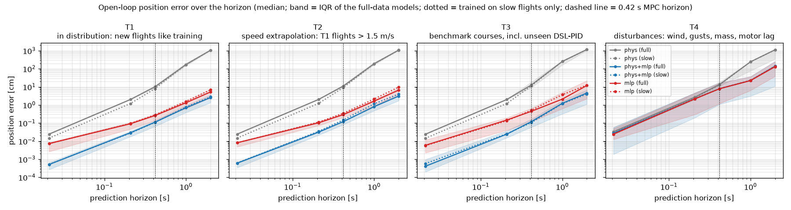
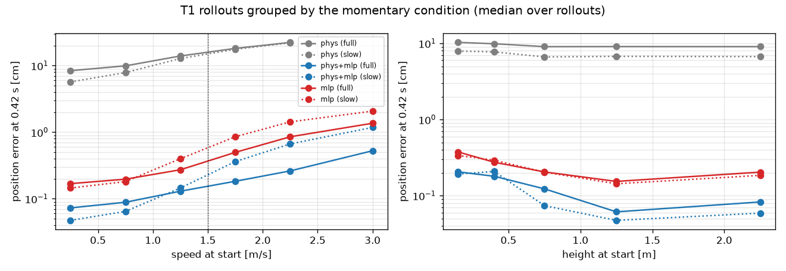
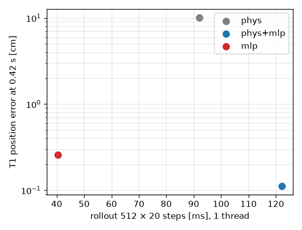
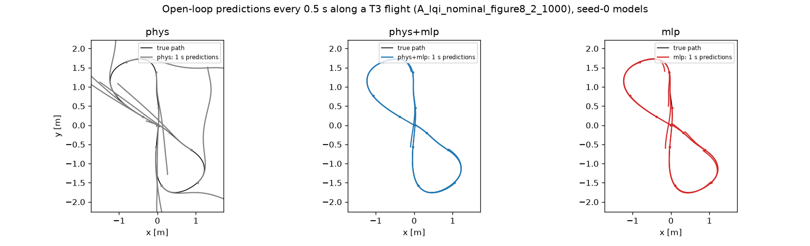
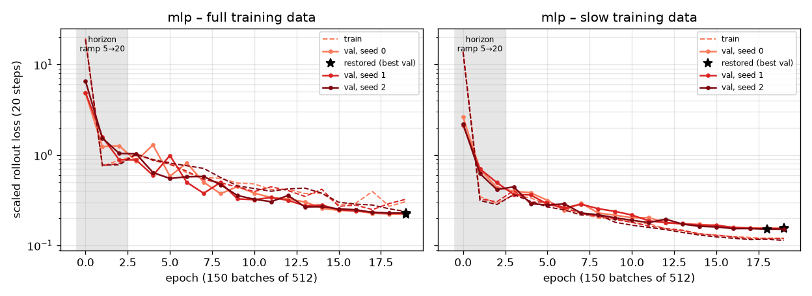

# Surrogate – results

Generated by `projects/surrogate/scripts/analyze.py`. Errors are open-loop rollouts with the recorded commands; per flight averaged over all start points (every 0.25 s), then median [IQR] over flights. Networks: mean of 3 training seeds per flight; ± = spread (SD) of the median over seeds.

## Main result (full training data)

**position error [cm]**

| set | model | n | 1 step | 0.21 s | 0.42 s | 1 s | 2 s |
|---|---|---|---|---|---|---|---|
| T1 | phys | 99 | 0.0 [0.0–0.0] | 2.0 [2.0–2.0] | 10.1 [9.0–11.6] | 170.8 [146.7–208.6] | 1057.4 [1020.1–1110.6] |
| T1 | phys+mlp | 99 | 0.0 [0.0–0.0] ±0.0 | 0.0 [0.0–0.0] ±0.0 | 0.1 [0.1–0.1] ±0.0 | 0.7 [0.4–0.9] ±0.0 | 2.5 [1.3–3.5] ±0.1 |
| T1 | mlp | 99 | 0.0 [0.0–0.0] ±0.0 | 0.1 [0.0–0.1] ±0.0 | 0.3 [0.1–0.3] ±0.0 | 1.3 [0.7–1.7] ±0.0 | 5.2 [2.5–7.4] ±0.1 |
| T2 | phys | 65 | 0.0 [0.0–0.0] | 2.0 [2.0–2.1] | 11.0 [10.0–12.6] | 189.2 [162.9–225.9] | 1079.0 [1047.6–1132.0] |
| T2 | phys+mlp | 65 | 0.0 [0.0–0.0] ±0.0 | 0.0 [0.0–0.0] ±0.0 | 0.1 [0.1–0.1] ±0.0 | 0.8 [0.5–1.0] ±0.0 | 3.1 [1.7–3.9] ±0.1 |
| T2 | mlp | 65 | 0.0 [0.0–0.0] ±0.0 | 0.1 [0.1–0.1] ±0.0 | 0.3 [0.2–0.4] ±0.0 | 1.6 [0.8–1.9] ±0.0 | 6.6 [3.9–8.5] ±0.3 |
| T3 | phys | 345 | 0.0 [0.0–0.0] | 2.0 [2.0–2.1] | 12.6 [9.1–18.5] | 253.2 [162.2–283.4] | 1162.2 [1039.9–1227.0] |
| T3 | phys+mlp | 345 | 0.0 [0.0–0.0] ±0.0 | 0.0 [0.0–0.0] ±0.0 | 0.1 [0.1–0.2] ±0.0 | 1.2 [0.3–1.7] ±0.2 | 4.5 [1.1–6.7] ±0.7 |
| T3 | mlp | 345 | 0.0 [0.0–0.0] ±0.0 | 0.1 [0.0–0.2] ±0.0 | 0.4 [0.1–0.6] ±0.0 | 2.1 [0.6–5.0] ±0.1 | 11.9 [2.2–22.1] ±0.4 |
| T4 | phys | 803 | 0.0 [0.0–0.1] | 2.7 [2.0–4.6] | 13.4 [11.0–18.0] | 241.8 [77.4–253.7] | 1112.7 [344.3–1157.0] |
| T4 | phys+mlp | 803 | 0.0 [0.0–0.1] ±0.0 | 2.2 [0.2–4.7] ±0.0 | 7.9 [1.1–16.2] ±0.0 | 22.4 [3.1–37.3] ±0.1 | 138.9 [10.7–261.9] ±0.5 |
| T4 | mlp | 803 | 0.0 [0.0–0.0] ±0.0 | 2.2 [0.3–4.6] ±0.0 | 7.8 [1.2–15.9] ±0.0 | 22.1 [6.4–36.6] ±0.1 | 129.4 [38.3–246.3] ±4.2 |

**attitude error [°]**

| set | model | n | 1 step | 0.21 s | 0.42 s | 1 s | 2 s |
|---|---|---|---|---|---|---|---|
| T1 | phys | 99 | 0.1 [0.1–0.1] | 7.3 [5.5–9.5] | 28.6 [21.0–37.0] | 105.6 [95.2–114.3] | 90.2 [79.8–98.8] |
| T1 | phys+mlp | 99 | 0.0 [0.0–0.0] ±0.0 | 0.1 [0.0–0.1] ±0.0 | 0.2 [0.1–0.2] ±0.0 | 0.6 [0.2–0.8] ±0.0 | 3.5 [1.5–4.7] ±0.2 |
| T1 | mlp | 99 | 0.0 [0.0–0.1] ±0.0 | 0.2 [0.1–0.3] ±0.0 | 0.4 [0.2–0.5] ±0.0 | 1.2 [0.5–1.7] ±0.0 | 7.1 [2.8–9.3] ±0.1 |
| T2 | phys | 65 | 0.1 [0.1–0.1] | 8.5 [6.8–11.1] | 32.8 [26.7–43.2] | 103.2 [93.1–112.3] | 91.2 [82.1–100.1] |
| T2 | phys+mlp | 65 | 0.0 [0.0–0.0] ±0.0 | 0.1 [0.0–0.1] ±0.0 | 0.2 [0.1–0.3] ±0.0 | 0.7 [0.3–0.8] ±0.0 | 4.3 [2.4–5.4] ±0.1 |
| T2 | mlp | 65 | 0.1 [0.0–0.1] ±0.0 | 0.3 [0.1–0.3] ±0.0 | 0.5 [0.2–0.6] ±0.0 | 1.5 [0.8–1.8] ±0.1 | 8.8 [4.8–10.2] ±0.1 |
| T3 | phys | 345 | 0.1 [0.1–0.2] | 11.9 [5.9–19.0] | 46.8 [23.2–73.7] | 92.1 [69.1–125.7] | 101.5 [83.2–121.9] |
| T3 | phys+mlp | 345 | 0.0 [0.0–0.0] ±0.0 | 0.1 [0.0–0.2] ±0.0 | 0.3 [0.1–0.4] ±0.0 | 0.8 [0.1–1.1] ±0.1 | 6.2 [1.1–8.7] ±0.7 |
| T3 | mlp | 345 | 0.0 [0.0–0.1] ±0.0 | 0.2 [0.0–0.5] ±0.0 | 0.6 [0.1–1.4] ±0.0 | 2.1 [0.4–5.5] ±0.0 | 10.5 [2.0–29.4] ±0.2 |
| T4 | phys | 803 | 0.1 [0.0–0.1] | 11.2 [0.9–12.1] | 43.0 [2.7–46.8] | 89.8 [10.2–106.3] | 83.4 [20.4–108.2] |
| T4 | phys+mlp | 803 | 0.0 [0.0–0.0] ±0.0 | 0.9 [0.1–2.1] ±0.0 | 3.0 [0.3–10.6] ±0.0 | 10.1 [0.9–38.8] ±0.0 | 44.8 [7.2–97.7] ±0.8 |
| T4 | mlp | 803 | 0.0 [0.0–0.1] ±0.0 | 1.0 [0.4–2.1] ±0.0 | 3.0 [1.0–10.6] ±0.0 | 10.9 [3.2–37.7] ±0.2 | 49.8 [19.0–111.8] ±1.5 |

**velocity error [m/s]**

| set | model | n | 1 step | 0.21 s | 0.42 s | 1 s | 2 s |
|---|---|---|---|---|---|---|---|
| T1 | phys | 99 | 0.019 [0.019–0.020] | 0.197 [0.190–0.208] | 0.703 [0.570–0.865] | 5.574 [5.027–6.251] | 11.584 [11.376–11.715] |
| T1 | phys+mlp | 99 | 0.000 [0.000–0.001] ±0.000 | 0.003 [0.002–0.003] ±0.000 | 0.007 [0.003–0.008] ±0.000 | 0.016 [0.009–0.021] ±0.000 | 0.117 [0.041–0.153] ±0.003 |
| T1 | mlp | 99 | 0.002 [0.001–0.002] ±0.000 | 0.007 [0.003–0.008] ±0.000 | 0.013 [0.006–0.016] ±0.000 | 0.036 [0.017–0.046] ±0.000 | 0.227 [0.097–0.302] ±0.005 |
| T2 | phys | 65 | 0.019 [0.019–0.020] | 0.205 [0.197–0.217] | 0.795 [0.679–0.986] | 5.847 [5.290–6.641] | 11.620 [11.468–11.759] |
| T2 | phys+mlp | 65 | 0.000 [0.000–0.001] ±0.000 | 0.003 [0.002–0.003] ±0.000 | 0.007 [0.004–0.008] ±0.000 | 0.019 [0.011–0.023] ±0.001 | 0.137 [0.072–0.174] ±0.003 |
| T2 | mlp | 65 | 0.002 [0.001–0.002] ±0.000 | 0.007 [0.005–0.008] ±0.000 | 0.015 [0.008–0.018] ±0.000 | 0.042 [0.027–0.052] ±0.001 | 0.284 [0.157–0.340] ±0.012 |
| T3 | phys | 345 | 0.019 [0.019–0.019] | 0.209 [0.189–0.263] | 1.030 [0.595–1.599] | 6.392 [5.666–7.061] | 11.928 [11.694–12.249] |
| T3 | phys+mlp | 345 | 0.000 [0.000–0.001] ±0.000 | 0.002 [0.001–0.004] ±0.000 | 0.008 [0.003–0.011] ±0.001 | 0.029 [0.007–0.041] ±0.004 | 0.164 [0.023–0.235] ±0.020 |
| T3 | mlp | 345 | 0.001 [0.000–0.004] ±0.000 | 0.011 [0.003–0.015] ±0.000 | 0.020 [0.005–0.036] ±0.001 | 0.076 [0.015–0.123] ±0.002 | 0.431 [0.069–0.701] ±0.018 |
| T4 | phys | 803 | 0.027 [0.019–0.046] | 0.262 [0.207–0.418] | 1.011 [0.679–1.147] | 7.074 [1.565–7.285] | 11.482 [3.670–11.833] |
| T4 | phys+mlp | 803 | 0.022 [0.002–0.046] ±0.000 | 0.203 [0.028–0.424] ±0.000 | 0.331 [0.031–0.676] ±0.001 | 1.002 [0.072–1.722] ±0.002 | 2.360 [0.401–4.919] ±0.016 |
| T4 | mlp | 803 | 0.022 [0.007–0.046] ±0.000 | 0.202 [0.030–0.421] ±0.001 | 0.327 [0.061–0.667] ±0.001 | 0.981 [0.202–1.713] ±0.004 | 2.314 [0.883–4.416] ±0.029 |

## Ablation: full data vs. slow flights only (≤ 1.5 m/s)

Median position error [cm] at 0.42 s (MPC horizon). T2 = T1 flights faster than 1.5 m/s.

| model | training data | T1 | T2 | T3 | T4 |
|---|---|---|---|---|---|
| phys | full | 10.12 | 10.98 | 12.64 | 13.43 |
| phys | slow | 7.93 | 8.95 | 11.25 | 12.69 |
| phys+mlp | full | 0.11 | 0.12 | 0.12 | 7.95 |
| phys+mlp | slow | 0.11 | 0.15 | 0.11 | 7.94 |
| mlp | full | 0.26 | 0.29 | 0.45 | 7.84 |
| mlp | slow | 0.28 | 0.35 | 0.51 | 7.82 |

## Paired comparison (Wilcoxon signed-rank, per flight, position error at 0.42 s)

| set | comparison | data | flights where A is better | median ratio A/B | p |
|---|---|---|---|---|---|
| T1 | phys+mlp vs mlp | full | 100% | 0.46 | 5.7e-18 |
| T1 | phys+mlp vs mlp | slow | 100% | 0.40 | 5.7e-18 |
| T1 | phys+mlp vs phys | full | 100% | 0.01 | 5.7e-18 |
| T1 | phys+mlp vs phys | slow | 100% | 0.01 | 5.7e-18 |
| T1 | mlp vs phys | full | 100% | 0.02 | 5.7e-18 |
| T1 | mlp vs phys | slow | 100% | 0.04 | 5.7e-18 |
| T2 | phys+mlp vs mlp | full | 100% | 0.44 | 2.4e-12 |
| T2 | phys+mlp vs mlp | slow | 100% | 0.42 | 2.4e-12 |
| T2 | phys+mlp vs phys | full | 100% | 0.01 | 2.4e-12 |
| T2 | phys+mlp vs phys | slow | 100% | 0.02 | 2.4e-12 |
| T2 | mlp vs phys | full | 100% | 0.03 | 2.4e-12 |
| T2 | mlp vs phys | slow | 100% | 0.04 | 2.4e-12 |
| T3 | phys+mlp vs mlp | full | 100% | 0.32 | 0.0e+00 |
| T3 | phys+mlp vs mlp | slow | 98% | 0.35 | 0.0e+00 |
| T3 | phys+mlp vs phys | full | 100% | 0.01 | 0.0e+00 |
| T3 | phys+mlp vs phys | slow | 100% | 0.01 | 0.0e+00 |
| T3 | mlp vs phys | full | 100% | 0.03 | 0.0e+00 |
| T3 | mlp vs phys | slow | 100% | 0.05 | 0.0e+00 |
| T4 | phys+mlp vs mlp | full | 30% | 1.01 | 2.0e-23 |
| T4 | phys+mlp vs mlp | slow | 38% | 1.01 | 1.6e-07 |
| T4 | phys+mlp vs phys | full | 81% | 0.63 | 0.0e+00 |
| T4 | phys+mlp vs phys | slow | 84% | 0.69 | 0.0e+00 |
| T4 | mlp vs phys | full | 82% | 0.62 | 0.0e+00 |
| T4 | mlp vs phys | slow | 86% | 0.68 | 0.0e+00 |

## T4 per scenario (position error [cm] at 0.42 s, median)

| scenario | flights | phys | phys+mlp | mlp |
|---|---|---|---|---|
| combo_mid | 45 | 18.90 | 19.31 | 19.09 |
| combo_strong | 11 | 48.64 | 49.92 | 47.13 |
| gust_0.01 | 45 | 12.28 | 3.73 | 3.71 |
| gust_0.02 | 45 | 13.40 | 7.43 | 7.34 |
| gust_0.04 | 45 | 17.59 | 14.78 | 14.61 |
| mass_0.8 | 45 | 24.24 | 15.16 | 14.84 |
| mass_0.9 | 45 | 17.68 | 7.50 | 7.28 |
| mass_1.1 | 45 | 9.66 | 7.42 | 7.29 |
| mass_1.2 | 45 | 12.19 | 14.71 | 14.51 |
| mass_1.3 | 45 | 17.40 | 21.86 | 21.67 |
| motor_0.05 | 45 | 12.78 | 1.83 | 1.78 |
| motor_0.1 | 27 | 7.97 | 1.31 | 1.40 |
| noise_high | 45 | 11.45 | 0.22 | 0.66 |
| noise_low | 45 | 12.27 | 0.12 | 0.21 |
| noise_mid | 45 | 12.16 | 0.13 | 0.28 |
| nominal | 45 | 12.27 | 0.10 | 0.17 |
| wind_0.03 | 45 | 12.71 | 8.17 | 8.06 |
| wind_0.06 | 45 | 17.97 | 16.32 | 16.08 |
| wind_0.09 | 45 | 25.64 | 24.38 | 24.00 |

## T3 per controller (position error [cm] at 0.42 s, median)

DSL-PID never flew in the training data.

| controller | flights | phys | phys+mlp | mlp |
|---|---|---|---|---|
| dsl_pid | 115 | 12.99 | 0.15 | 0.64 |
| lqi | 115 | 12.54 | 0.08 | 0.17 |
| pid | 115 | 12.46 | 0.08 | 0.17 |

## Identified physics parameters

True values of the simulator for comparison. The fitted values are *effective* parameters: thrust also absorbs the average inflow and ground effect, the rotor drag also the body drag – so they are not expected to match exactly.

| parameter | PyBullet value | phys full | phys slow | phys+mlp full (seed 0) |
|---|---|---|---|---|
| kf | 3.160e-10 | 2.863e-10 | 2.987e-10 | 3.133e-10 |
| km | 7.940e-12 | 7.844e-12 | 7.835e-12 | 7.804e-12 |
| kd_xy | 9.179e-07 | 2.119e-06 | 2.216e-06 | 1.572e-06 |
| kd_z | 1.031e-06 | 2.022e-06 | 2.074e-06 | 2.927e-06 |
| tau | 2.000e-02 | 1.614e-02 | 1.716e-02 | 1.922e-02 |

## Compute

Rollout of 512 command sequences × 20 steps (incl. 8 warm-up steps), one CPU thread (i5-7300U), torch eager mode. Training time: mean over seeds.

| model | parameters | rollout 512 × 20 [ms] | training [min] | epochs |
|---|---|---|---|---|
| phys | 5 | 92 | 9 | 10 |
| phys+mlp | 26635 | 122 | 27 | 20 |
| mlp | 24582 | 40 | 8 | 20 |

**Window search** (validation loss, seed 0, shorter training): `phys_mlp_w1` 0.109, `phys_mlp_w4` 0.096, `phys_mlp_w8` 0.127, `mlp_w1` 11.212, `mlp_w4` 0.389, `mlp_w8` 0.414 → chosen: {'phys+mlp': 4, 'mlp': 4}

## Figures

